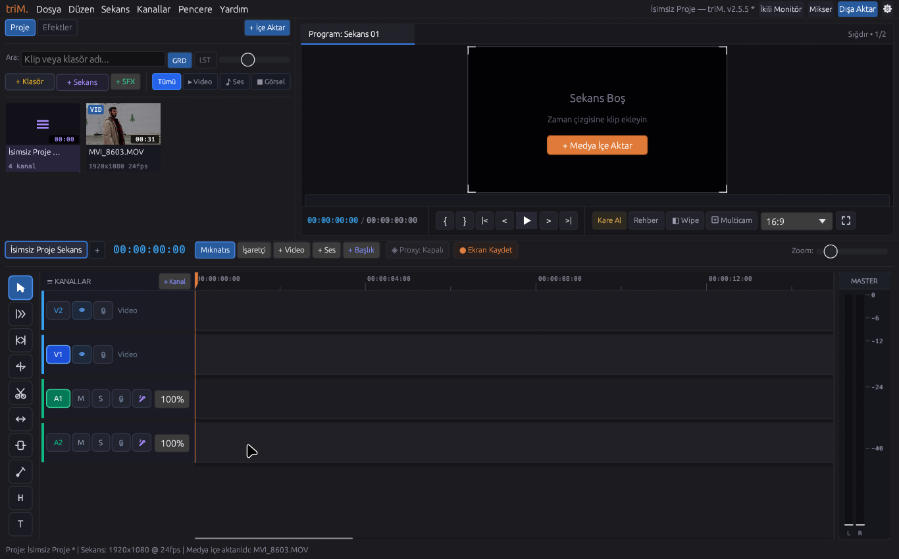
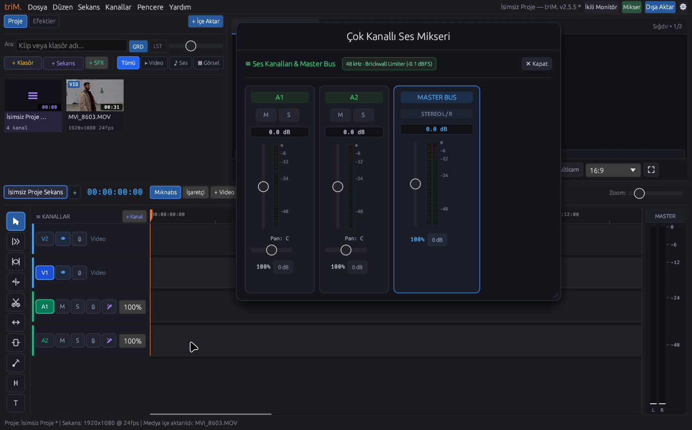
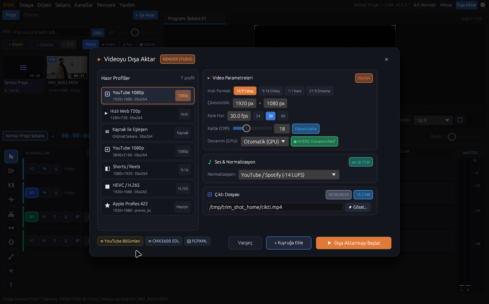
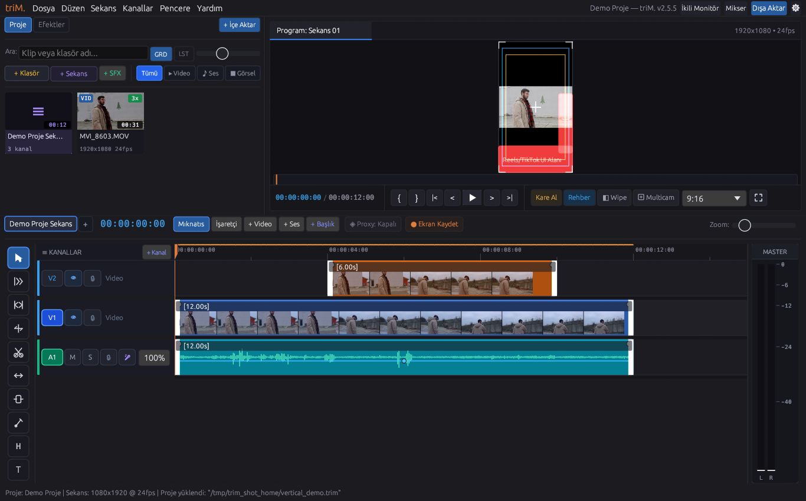

<h1 align="center">triM.</h1>

<p align="center">
  Fast, lightweight non-linear video editor for Linux and Windows.
</p>

<p align="center">
  <a href="Cargo.toml"></a>
  <a href="LICENSE"></a>
  
  <a href="https://github.com/MOzcelik14/triM/actions"></a>
</p>

<p align="center">
  <a href="README.tr.md">Türkçe</a> · <a href="docs/SHORTCUTS.md">Keyboard Shortcuts</a> · <a href="https://mozcelik14.github.io/triM">Website</a>
</p>

---



## Overview

**triM.** is a native desktop video editor built for creators who want responsive timeline editing without heavy resource consumption, cloud subscriptions, or account requirements. It launches quickly, works completely offline, and integrates seamlessly into the **prisM. Suite** ecosystem.

## Key Features

- **Multi-Track Timeline**: Organize video and audio tracks with magnetic snapping, clip linking, markers, and precision editing tools (Selection, Razor, Ripple, Slip, and Text).
- **Smart Assistance**: Automatic scene detection, silence removal (jump-cut), and local speech-to-text subtitle generation.
- **Color & Compositing**: 3-way color wheels (Lift, Gamma, Gain), `.cube` 3D LUT support, chroma keying, opacity fades, and transform keyframes.
- **Audio & Recording**: Built-in multi-track audio mixer with 3-band EQ, loudness limiting, direct microphone voiceover, and screen/webcam capture.
- **Smooth 4K Editing**: Optional 720p proxy mode for fluid scrubbing on high-resolution footage.
- **Flexible Export**: Export to H.264, HEVC, VP9, AV1, ProRes, and DNxHR with hardware acceleration support, background render queue, EBU R128 loudness normalization, and FCPXML/EDL interchange.
- **Customizable Workflow**: Bilingual interface (English / Turkish), scalable UI, and familiar shortcut presets (triM. Default, Premiere Pro, DaVinci Resolve).

## Screenshots

| Color Grading | Audio Mixer |
| :---: | :---: |
|  |  |

| Export Studio | Vertical (9:16) Canvas |
| :---: | :---: |
|  |  |

---

## Download & Installation

You can install and keep **triM.** up to date automatically via [prisM. Suite](https://github.com/MOzcelik14/prism-suite), or download packages directly from [GitHub Releases](https://github.com/MOzcelik14/triM/releases).

### Quick Install

**Linux:**
```bash
curl -fsSL https://raw.githubusercontent.com/MOzcelik14/triM/master/install.sh | bash
```

**Windows (PowerShell):**
```powershell
iwr -useb https://raw.githubusercontent.com/MOzcelik14/triM/master/install.ps1 | iex
```

Windows release archives include portable FFmpeg binaries. On Linux, ensure `ffmpeg` and `ffprobe` are installed on your system.

## System Requirements

- **OS**: Linux (x86_64) or Windows 10/11 (x86_64)
- **Graphics**: OpenGL 3.3+ compatible GPU
- **Dependencies**: `ffmpeg` and `ffprobe` in system `PATH` (bundled on Windows)

## Essential Shortcuts

| Key | Action |
| :--- | :--- |
| `Space` | Play / Pause |
| `J` / `K` / `L` | Shuttle backward / Stop / Shuttle forward |
| `V` / `C` / `B` | Selection / Razor / Ripple tool |
| `S` / `Ctrl + K` | Split clip at playhead |
| `Ctrl + M` | Open Export Studio |
| `Ctrl + ,` | Open Settings |
| `F1` | View all shortcuts |

See [docs/SHORTCUTS.md](docs/SHORTCUTS.md) for the complete shortcut reference.

## Building from Source

Requires Rust 1.80+:

```bash
git clone https://github.com/MOzcelik14/triM.git
cd triM
cargo build --release -p trim-app
```

## License

Licensed under the **GNU General Public License v3.0 (GPL-3.0)**. See [LICENSE](LICENSE) for details.
