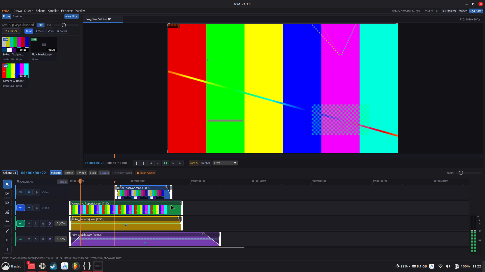
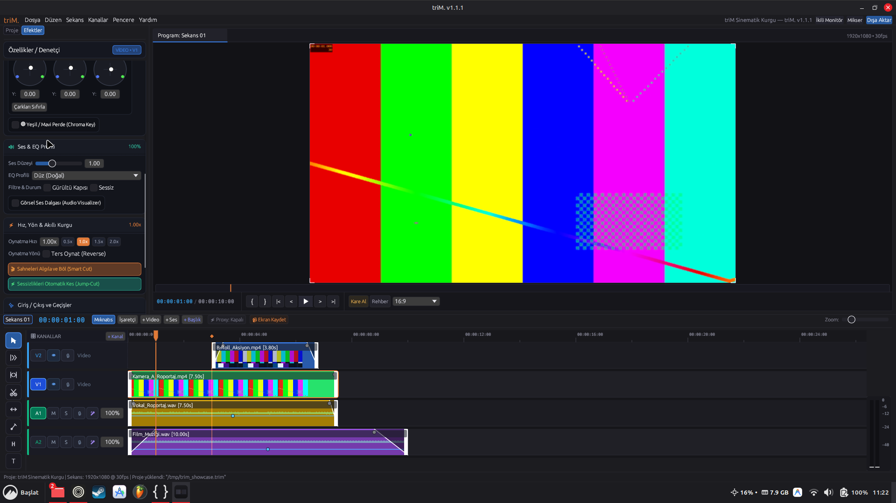
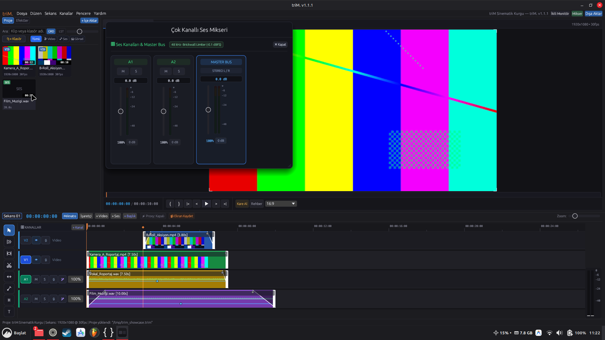
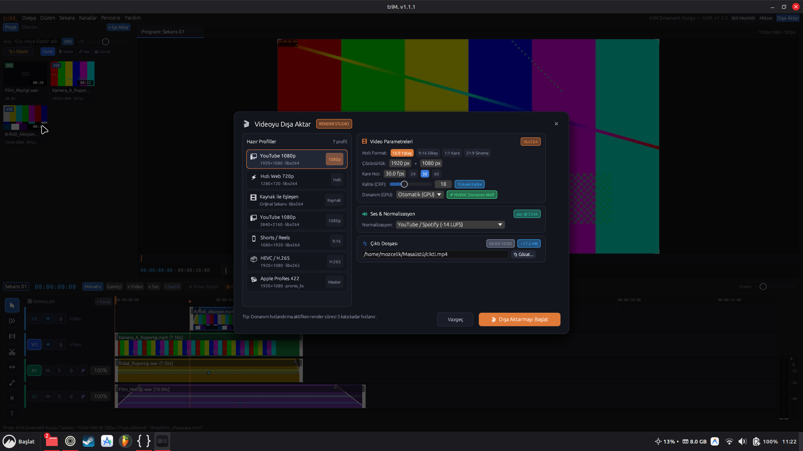
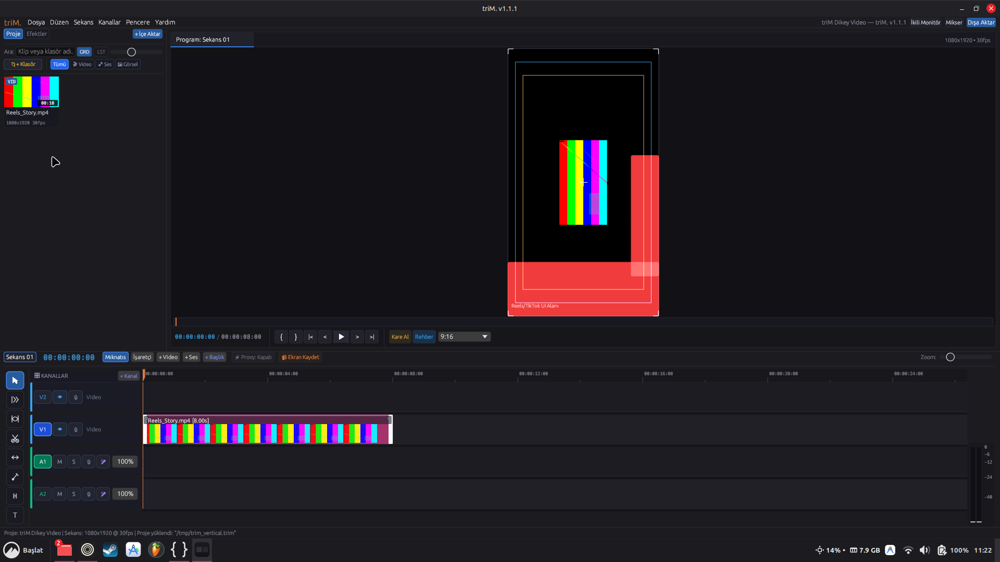

# triM.

[](Cargo.toml)
[](Cargo.toml)
[](LICENSE)
[](#system-requirements)
[](https://github.com/MOzcelik14/triM/actions)

[Türkçe README için tıklayın](README.tr.md) · [Keyboard Shortcuts](docs/SHORTCUTS.md) · [Website](https://mozcelik14.github.io/triM)

triM. is a native, lightweight non-linear video editor written in Rust with `egui`, using system FFmpeg for media decoding and encoding.



---

## Why I Built This

Most existing video editing software either requires hundreds of megabytes of disk space or runs inside a web browser runtime (Electron), leading to high memory overhead. For personal editing projects, I wanted a tool that starts quickly, has no external cloud or account dependencies, relies on local tools (FFmpeg, PipeWire), and keeps resource usage low.

I built triM. to serve that need. The user interface is rendered using `egui` and `eframe` over OpenGL, while video and audio decoding tasks are delegated to `ffmpeg` and `ffprobe` processes. The compiled release binary is approximately 13 MB.

---

## Core Features

### Editing & Timeline
- Multi-track video and audio timeline (V1..Vn, A1..An)
- Razor (C), Ripple (B), Slip (Y), Selection (V), and Type (T) editing tools
- Magnetic snapping to playhead and clip boundaries (toggle with N)
- Automatic video-to-audio clip linking and pairing (V1 -> A1, V2 -> A2 mapping, toggle with Ctrl+L)
- Smart Scene Detection ("Smart Cut") using scene change analysis
- Jump-Cut Silence Detection to automatically slice pauses and silence
- Local Speech-to-Text subtitle transcription using Whisper (`whisper.cpp`)
- Timeline markers for visual navigation

### Color & Effects
- GPU-accelerated compositing and blending pipeline (OpenGL FBO shaders)
- 3-Way Color Wheels (Lift, Gamma, Gain) with instant preview
- 3D LUT support via standard `.cube` files
- Chroma Keying (green screen / blue screen removal with threshold controls)
- Opacity controls with linear fade-in and fade-out transitions
- Keyframe support for position, scale, rotation, and opacity

### Audio Processing & Voiceover
- Real-time software multi-track PCM mixer (48 kHz stereo)
- Per-track gain (dB), Mute, and Solo controls
- 3-band parametric equalizer and presets (Voice clarity, bass boost, etc.)
- Timeline voiceover recording directly from microphone
- Built-in screen & webcam recording studio
- 5 ms lookahead brickwall master peak limiter to eliminate audio clipping

### Performance & Usability
- **Smart Proxy Editing:** Instant 720p H.264 proxy playback mode for smooth 4K/60fps scrubbing
- **Preferences & Settings (`Ctrl+,`):** Modular settings dialog for language, UI scaling (80%-150%), snapping, proxy presets, limiter threshold, and disk cache cleanup
- **Internationalization (i18n):** Bilingual interface supporting both Turkish (TR) and English (EN)
- **Keyboard Profiles:** Switch shortcuts between triM. Default, Adobe Premiere Pro, and DaVinci Resolve

### Export & Industry Interchange
- Export in H.264, HEVC, VP9, AV1, ProRes, and DNxHR codecs
- Automatic hardware encoder detection (NVIDIA NVENC, Intel QSV, AMD AMF, Linux VAAPI) with CPU fallback
- Background Render Queue (`Ctrl+Shift+E`) for batch exporting multiple sequences
- EBU R128 loudness normalization (`loudnorm`) during export
- Sequence interchange via Final Cut Pro (`.fcpxml` v1.8/v1.9) and CMX 3600 (`.edl`)

---

## Screenshots

| Color Grading (Lift/Gamma/Gain) | Audio Mixer & Parametric EQ |
|---|---|
|  |  |

| Export Studio | Vertical (9:16) Canvas with Safe Zones |
|---|---|
|  |  |

---

## Installation

### System Requirements
- **OS:** Linux (x86_64) or Windows (x86_64) *(macOS source buildable via `avfoundation`)*
- **Graphics:** OpenGL 3.3+ capable driver
- **Dependencies:** `ffmpeg` and `ffprobe` in `$PATH`
- **Audio Output:** PipeWire (`pw-cat`), PulseAudio (`paplay`), or ALSA (`aplay`) on Linux; DirectSound / waveOut on Windows

### Pre-built Binaries
Download `.deb`, `.rpm`, `.AppImage` (Linux) or `.zip` (Windows) packages from [GitHub Releases](https://github.com/MOzcelik14/triM/releases). Windows release ZIPs come pre-bundled with portable FFmpeg and FFprobe binaries—no external setup required.

One-line installation on Linux:
```bash
curl -fsSL https://raw.githubusercontent.com/MOzcelik14/triM/master/install.sh | bash
```

One-line installation on Windows (PowerShell):
```powershell
iwr -useb https://raw.githubusercontent.com/MOzcelik14/triM/master/install.ps1 | iex
```

### Building From Source
Requires Rust 1.80+ toolchain:

```bash
git clone https://github.com/MOzcelik14/triM.git
cd triM
cargo build --release -p trim-app
install -m 0755 target/release/trim ~/.local/bin/trim
```

---

## Usage

Launch the editor or pass a project file:

```bash
trim
trim /path/to/project.trim
```

### Primary Shortcuts

| Key | Action |
|---|---|
| `Space` | Play / Pause |
| `J` / `K` / `L` | Shuttle backwards / Stop / Shuttle forwards (2x, 4x, 8x) |
| `C` | Razor tool |
| `S` / `Ctrl + K` | Split clip at playhead |
| `V` | Selection tool |
| `B` | Ripple edit tool |
| `Delete` | Remove selected clip |
| `Shift + Delete` | Ripple delete clip and close gap |
| `Ctrl + M` | Open Export Studio |
| `Ctrl + Shift + E` | Open Render Queue |
| `Ctrl + ,` | Open Preferences / Settings |
| `F1` | Open keyboard shortcuts window |

See [docs/SHORTCUTS.md](docs/SHORTCUTS.md) for the full shortcut list.

---

## Architecture

The project is structured as 8 distinct Cargo workspace crates:

```
triM/
├── crates/
│   ├── trim-core/       # Domain models, timecode math, clips, tracks, and projects
│   ├── trim-commands/   # Reversible Command implementations and Undo/Redo stack
│   ├── trim-timeline/   # Editing, slicing, and split algorithms
│   ├── trim-project/    # Disk serialization (.trim), autosave, and crash recovery
│   ├── trim-media/      # FFmpeg process supervision, frame streaming, and audio mixing
│   ├── trim-export/     # FFmpeg filtergraph generation, EDL, and FCPXML writers
│   ├── trim-ui/         # Immediate-mode egui canvas, monitors, and inspector
│   └── trim-app/        # Executable binary entry point
```

See [ARCHITECTURE.md](ARCHITECTURE.md) for details on the threading model, memory limits, and subprocess lifecycle guards.

---

## Memory & Performance Notes

1. **Memory Footprint:** While the standalone binary is approximately 13 MB, runtime RAM consumption scales with your media. triM enforces hard bounds to prevent unbounded memory growth: video frame previews are capped at a 300-frame LRU cache (~276 MB), and the multi-track PCM audio cache is capped at 512 MB. Disk cache can be inspected and purged at any time in **Preferences (`Ctrl+,`)**.
2. **Subprocess Media Architecture:** Instead of dynamically linking complex C libraries (`libavcodec`), triM. calls system FFmpeg as isolated child processes (`ChildGuard`). This guarantees that unexpected codec crashes never terminate the editing UI. Uncached seeking on long-GOP video files can be made instantaneous by enabling **Smart Proxy** mode in the Sequence menu or Preferences.
3. **Hardware Acceleration:** Real-time layer blending, 3-way color wheels, 3D LUTs, and green screen keys run directly on the GPU via OpenGL shaders. Video export supports hardware encoding (NVENC, QSV, AMF, VAAPI) with automatic fallback to `libx264` if hardware drivers are unavailable.
4. **Platform Scope:** Timeline playback, microphone voiceover, and desktop/webcam recording are supported on both Linux and Windows. macOS support uses native `avfoundation` inputs in source code, with automated macOS release packages planned.
5. **Color Depth:** The preview pipeline operates in 8-bit sRGB for maximum GUI responsiveness; export renders at source bit-depth through FFmpeg.

---

## License

This project is licensed under the [GNU General Public License v3.0 or later (GPL-3.0-or-later)](LICENSE).
