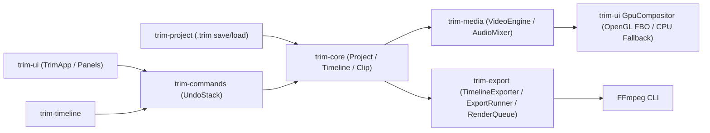

<p align="right">
  <strong>English</strong> | <a href="README.tr.md">Türkçe</a>
</p>

<div align="center">

<h1>triM.</h1>

<p>A lightweight, local-first non-linear desktop video editor built with Rust, egui, OpenGL, and FFmpeg.</p>

<p>
  <a href="LICENSE"></a>
  <a href="https://github.com/MOzcelik14/triM/releases"></a>
  <a href="https://www.rust-lang.org/"></a>
  <a href="#system-requirements"></a>
  <a href="https://github.com/MOzcelik14/triM/actions/workflows/ci.yml"></a>
  <a href="https://github.com/MOzcelik14/triM/commits/master"></a>
  <a href="https://github.com/MOzcelik14/prism-suite"></a>
</p>

<p>
  <a href="#overview">Overview</a> |
  <a href="#features">Features</a> |
  <a href="#installation">Installation</a> |
  <a href="#keyboard-shortcuts">Keyboard Shortcuts</a> |
  <a href="#architecture">Architecture</a> |
  <a href="#development">Development</a>
</p>

<p>
  
</p>

</div>

---

## Overview

**triM.** is an open-source, non-linear video editor (NLE) for Linux and Windows developed in Rust. It is designed for creators, technical editors, and small teams who need a responsive desktop editing environment without subscriptions, cloud dependencies, or account requirements. All decoding, preview compositing, audio mixing, speech transcription, and final rendering run locally on the host machine.

The application combines an immediate-mode desktop interface built with `egui` and `eframe`, an OpenGL 3.3 / GLES 3.0 framebuffer preview compositor (`glow`) with automatic CPU fallback, and an FFmpeg-backed media and export pipeline. Projects are stored in human-readable `.trim` JSON files with atomic saves, portable bundling, and crash recovery.

**triM.** is developed as part of the **prisM. Suite** ecosystem alongside **steM.**, **beaM.**, and **draM.**.

## Highlights

- **Local-first architecture**: Runs completely offline with zero telemetry, no accounts, and direct filesystem access to media and `.trim` project files.
- **Multi-track editing with deterministic Undo/Redo**: Unlimited video and audio tracks, linked clip groups, compound and nested sequences, magnetic snapping, markers, and a bounded 200-step command stack.
- **Color grading, scopes, and compositing**: Lift/Gamma/Gain color wheels, custom RGB/Luma spline curves, 6-vector HSL curves, 3D HSL qualifier, `.cube` 3D LUTs, Quad Scope (2x2), CIE 1931 chromaticity, split-screen wipe, vector masks, and 11 blend modes.
- **Integrated audio DSP and capture**: 48 kHz stereo mixer with per-clip 6-band parametric EQ, compressor, limiter, de-esser, stereo pan, reverb/echo, master lookahead brickwall limiter, audio scrubbing, and built-in voiceover/screen recording.
- **Hardware-aware FFmpeg export and interchange**: Preset-driven MP4/MOV/ProRes rendering with runtime encoder probing (NVENC, QSV, VAAPI, AMF, VideoToolbox, CPU), sequential render queue, YouTube/MP4 chapters, and CMX 3600 EDL / FCPXML import and export.

## Features

### Timeline and Editing

| Feature | Details |
| :--- | :--- |
| Multi-track timeline | Unlimited video and audio tracks with visibility, mute, solo, lock, height resizing, and color labels. |
| Editing tools | Selection (`V`), Track Select (`A`), Ripple (`B`), Razor (`C`), Slip (`Y`), Pen (`P`), Hand (`H`), and Type (`T`). |
| Precision trimming | Standard trim, ripple trim head (`Q`) and tail (`W`), ripple delete (`Shift+Delete`), close gap, and join through-edits. |
| Multi-clip operations | Rubberband multi-select, batch dragging, copy/cut/paste, Paste Attributes (`Ctrl+Alt+V`), clip linking (`Ctrl+L`), and audio detachment. |
| Compound and nested sequences | Group selected clips into a Compound Clip or manage multiple sequences within a single project. |
| Multicam workflow | 2x2 Program Monitor multicam view with live angle switching via keys `1` through `4`. |
| Navigation and snapping | Timeline markers (`M`), magnetic snapping (`N`), filmstrip clip thumbnails, audio waveforms, and JKL shuttle playback with audio scrubbing. |
| Speed and motion | Constant clip speed, reverse playback, variable speed ramping with 6 presets, pitch lock toggle, and Cubic Bezier / Ease-In / Ease-Out / Hold keyframe interpolation. |

### Color Grading, Scopes, and Visual Effects

| Feature | Details |
| :--- | :--- |
| Primary grading | Exposure/brightness, contrast, saturation, gamma, temperature, tint, one-click Auto White Balance, and one-click Shot Match against a reference still. |
| Curves and qualifier | Custom RGB and Luma spline curves, 6-vector HSL curves, and 3D HSL Qualifier with matte preview and invert toggle. |
| Color wheels and LUTs | Lift/Gamma/Gain color wheels, 20+ built-in looks, and custom 3D `.cube` LUT files with LRU caching. |
| Video scopes and reference | Single and 2x2 Quad Scope views (RGB Parade, Luma Waveform, Vectorscope, Histogram, CIE 1931 Chromaticity), False Color, Zebra, live pixel readout reticle, Split-Screen Wipe, and Reference Still Gallery. |
| Compositing and masks | 11 blend modes, Adjustment Layers, Rectangle/Ellipse/Bezier masks (Clip Alpha and Color/Effects targets), region motion tracking (SAD block matching), Chroma Key, Track Matte, and 4-Corner Perspective Pin. |
| Lens FX and transitions | Blur, sharpen, vignette, film grain, halation, bloom, chromatic aberration, and transitions including Cross Dissolve, Blur Dissolve, Luma Wipe, Whip Pan, Zoom Out, Glitch, and Light Leak. |

### Audio Processing and Capture

| Feature | Details |
| :--- | :--- |
| Multi-track mixer | Track volume, stereo pan, mute, solo, master bus gain, dual L/R VU meters, and a 5 ms stereo-linked lookahead brickwall limiter (`-0.1 dBFS` ceiling). |
| Per-clip DSP | Persistent per-clip DSP state with 6-band parametric EQ, EQ presets (Voice Clarity, Bass Boost, Podcast, Denoise Gate), compressor/limiter/de-esser, stereo pan, reverb/echo, and volume automation keyframes. |
| Smart audio tools | Onset-envelope Audio Waveform Auto-Sync, automatic silence detection and removal, and auto-ducking. |
| Built-in recording | Live microphone voiceover capture directly onto the timeline and screen/webcam recording. |

### Titles, Subtitles, and Delivery

| Feature | Details |
| :--- | :--- |
| Titles and typography | Direct-on-monitor text editing, 31 curated popular font families with OS font discovery, bold/italic, outline stroke width/color, letter spacing, shadow distance, background box, and motion styles (Lower Third, Typewriter, Cinematic Zoom). |
| Subtitles and transcription | SRT and VTT import, SRT export, karaoke/word-highlight styling, and local background Whisper speech-to-text transcription. |
| Export and render queue | Export presets for 1080p, 720p, 4K UHD, 9:16 vertical, H.265/HEVC, and Apple ProRes 422, loudness normalization (YouTube `-14 LUFS`, Podcast `-16 LUFS`, EBU R128 `-23 LUFS`), In/Out range export, and a sequential background Render Queue. |
| Interchange and chapters | CMX 3600 EDL and FCPXML (`xmeml` / modern FCPXML) import and export, YouTube chapter list export, and embedded MP4 chapter metadata. |

## Screenshots

| Color Grading and Scopes | Multi-Track Audio Mixer |
| :---: | :---: |
|  |  |

| Export Studio | Vertical (9:16) Canvas |
| :---: | :---: |
|  |  |

<!-- Additional screenshots can be placed in docs/images/ and linked here. -->

## Installation

### Prebuilt Packages (GitHub Releases)

Download prebuilt packages from the [Releases](https://github.com/MOzcelik14/triM/releases) page. The release workflow builds the following artifacts:

- **Debian / Ubuntu**: `.deb` package
- **Fedora / RHEL**: `.rpm` package
- **Linux portable**: `.AppImage` and `.tar.gz` archive
- **Windows (x86_64 MSVC)**: `.zip` bundle (includes `ffmpeg.exe`, `ffprobe.exe`, and `ffplay.exe`)

### Automated Install Scripts

**Linux:**
```bash
curl -fsSL https://raw.githubusercontent.com/MOzcelik14/triM/master/install.sh | bash
```

**Windows (PowerShell):**
```powershell
iwr -useb https://raw.githubusercontent.com/MOzcelik14/triM/master/install.ps1 | iex
```

### Distribution Package Commands (Linux)

After downloading the release package for your distribution:

**Debian / Ubuntu (`.deb`):**
```bash
sudo apt install ./trim_*.deb
```

**Fedora (`.rpm`):**
```bash
sudo dnf install ./trim-*.rpm
```

**AppImage:**
```bash
chmod +x triM-*.AppImage
./triM-*.AppImage
```

### Building from Source

#### Prerequisites

- **Rust** stable toolchain (edition 2021) with `cargo`
- **FFmpeg** and **FFprobe** available in `PATH` (optional: `ffplay` on Windows, `pw-cat`/`paplay`/`aplay` on Linux for audio output, and `whisper-cli` or `openai-whisper` for local transcription)
- **Linux development libraries** (Ubuntu / Debian):

```bash
sudo apt-get update
sudo apt-get install -y \
  build-essential pkg-config \
  libasound2-dev libpipewire-0.3-dev \
  libx11-dev libgl1-mesa-dev libxkbcommon-dev libwayland-dev \
  ffmpeg
```

#### Compile and Run

```bash
git clone https://github.com/MOzcelik14/triM.git
cd triM
cargo build --release -p trim-app
./target/release/trim
```

## Getting Started

1. Launch **triM.** (`./target/release/trim` on Linux or `trim.exe` on Windows) and create a new project from the welcome screen or with `Ctrl+N`.
2. Import video, audio, or image assets via `Ctrl+I`, the Media Bin import button, or drag-and-drop onto the window.
3. Drag clips from the Media Bin onto video (`V1`, `V2`, ...) and audio (`A1`, `A2`, ...) tracks. For 4K footage on modest hardware, enable Smart Proxy (720p) in the Media Bin or Preferences.
4. Use `Space` or `J`/`K`/`L` to review playback, `S` (or `C` for Razor) to split clips, `Q`/`W` to ripple trim to the playhead, and `M` to drop timeline markers.
5. Select any clip to adjust Transform, Speed, Color Grading, Curves, Masks, or Audio EQ/Compressor in the right-hand Inspector panel.
6. Press `Ctrl+M` (or `Ctrl+E`) to open the Export Studio, choose an export preset and hardware encoder, and render immediately or add the job to the Render Queue (`Ctrl+Shift+E`).

## Keyboard Shortcuts

Shortcuts below are verified directly against `crates/trim-ui/src/app.rs`. Shortcut profiles (`triM Default`, `Premiere Pro`, `DaVinci Resolve`) can be switched in Preferences (`Ctrl+,`) or viewed in-app via `F1`.

### Transport and Navigation

| Shortcut | Action |
| :--- | :--- |
| `Space` | Play / Pause |
| `J` / `K` / `L` | Shuttle Reverse / Stop / Shuttle Forward (press repeatedly for 2x, 4x, 8x) |
| `Left` / `Right` | Step 1 frame backward / forward |
| `Shift + Left` / `Shift + Right` | Jump 1 second backward / forward |
| `Up` / `Down` | Jump to previous / next edit point |
| `Home` / `End` | Jump to timeline start / end |
| `I` / `O` | Set Mark In / Mark Out (and `Alt + X` to clear In/Out) |
| `F11` / `Esc` | Toggle / exit fullscreen Program Monitor |

### Tools and Timeline Editing

| Shortcut | Action |
| :--- | :--- |
| `V` (DaVinci: `A`) | Selection Tool |
| `A` (non-DaVinci) | Track Select Tool |
| `B` (DaVinci: Razor) | Ripple Edit Tool |
| `C` (non-DaVinci) | Razor / Cut Tool |
| `Y` | Slip Edit Tool |
| `P` | Pen / Keyframe Tool |
| `H` | Hand / Pan Tool |
| `T` | Type / Text Tool |
| `S` / `Ctrl + K` / `Ctrl + \` | Split clip at playhead (depends on profile) |
| `Q` / `W` | Ripple Trim Head / Ripple Trim Tail at playhead |
| `Delete` / `Backspace` | Delete selected clip(s) |
| `Shift + Delete` | Ripple Delete selected clip(s) |
| `,` / `.` | Insert / Overwrite from Source Monitor |
| `M` | Add timeline marker at playhead |
| `N` | Toggle magnetic snapping |
| `1` - `4` | Switch active angle in Multicam mode |
| `Ctrl + =` / `Ctrl + -` | Zoom timeline in / out |

### Project, Clipboard, and Panels

| Shortcut | Action |
| :--- | :--- |
| `Ctrl + N` / `Ctrl + O` / `Ctrl + S` | New Project / Open Project / Save Project |
| `Ctrl + Z` | Undo |
| `Ctrl + Y` or `Ctrl + Shift + Z` | Redo |
| `Ctrl + C` / `Ctrl + X` / `Ctrl + V` | Copy / Cut / Paste clips |
| `Ctrl + Alt + V` | Open Paste Attributes dialog |
| `Ctrl + L` | Link / Unlink selected clips |
| `Ctrl + R` | Open Clip Speed / Duration dialog |
| `Ctrl + T` | Open New Title dialog |
| `Ctrl + I` | Import media |
| `Ctrl + M` or `Ctrl + E` | Open Export Studio |
| `Ctrl + Shift + E` | Toggle Render Queue |
| `Ctrl + ,` | Open Preferences |
| `F1` | Toggle Keyboard Shortcuts guide |
| `Ctrl + Q` | Quit application |

## Supported Formats

| Category | Formats / Extensions |
| :--- | :--- |
| Video input | `.mp4`, `.mov`, `.mkv`, `.webm`, `.m4v`, `.avi`, `.ts`, `.mts`, `.m2ts` (including Sony XAVC `ipcm`/`lpcm` audio atom detection) |
| Audio input | `.mp3`, `.wav`, `.aac`, `.flac`, `.ogg`, `.m4a` |
| Image input | `.png`, `.jpg`, `.jpeg`, `.webp`, `.bmp`, `.tiff`, `.gif` |
| Color LUTs | 3D `.cube` LUT files |
| Subtitles | `.srt` (import and export), `.vtt` (import) |
| Project and interchange | `.trim` (native project, plus legacy `.cutline` load compatibility), `.edl` (CMX 3600 import/export), `.xml` (FCPXML import/export) |
| Video export containers and codecs | `.mp4` and `.mov` with `libx264`, `libx265`, `prores_ks` (`yuv422p10le`), and hardware encoders (`h264_nvenc`, `hevc_nvenc`, `h264_qsv`, `hevc_qsv`, `h264_vaapi`, `hevc_vaapi`, `h264_amf`, `hevc_amf`, `h264_videotoolbox`, `hevc_videotoolbox`) |
| Audio export codecs | `aac`, `pcm_s16le` (48 kHz stereo pipeline with optional LUFS loudness normalization) |

## Configuration and Data

**triM.** stores configuration, crash-recovery snapshots, and reproducible caches in OS-standard user directories defined in `crates/trim-core/src/paths.rs`:

| Data Type | Linux Path | Windows Path |
| :--- | :--- | :--- |
| User preferences | `$HOME/.config/trim/preferences.json` | `%APPDATA%\triM\preferences.json` |
| Crash recovery snapshots | `$HOME/.config/trim/recovery/` | `%APPDATA%\triM\recovery\` |
| Disk caches (thumbnails, filmstrips, waveforms, proxies) | `$HOME/.cache/trim/` | `%LOCALAPPDATA%\triM\` |
| Default export folder | `$HOME/Videos` (or `Videolar` / `Masaüstü` / `Desktop`) | `%USERPROFILE%\Videos` |

Projects are saved wherever you choose as `.trim` JSON files. Using **Bundle Project** copies source media, proxies, and custom `.cube` LUTs into a self-contained portable folder alongside the `.trim` file.

## System Requirements

| Component | Minimum | Recommended |
| :--- | :--- | :--- |
| Operating System | 64-bit Linux (Ubuntu 24.04 / Fedora or equivalent) or Windows 10 / 11 (64-bit) | 64-bit Linux (Wayland or X11) or Windows 11 (64-bit) |
| CPU | 64-bit multi-core processor | 6+ cores for multi-track decoding and software x264/x265 export |
| GPU | OpenGL 3.3 Core or OpenGL ES 3.0 capable GPU (CPU fallback supported) | GPU with NVENC, Intel QSV, AMD AMF, or VAAPI hardware encoding |
| Memory (RAM) | 4 GB (configurable RAM cache budget: 256 MB - 2048 MB) | 8 GB or more for 4K and long-form timelines |
| Runtime Dependencies | `ffmpeg` and `ffprobe` (bundled in Windows release zip) | Hardware encoder drivers + optional `whisper-cli` for local speech-to-text |

## Architecture

The workspace is organized into eight Rust crates with strict separation between core domain state, reversible commands, media decoding, FFmpeg export, and the desktop UI:

| Crate | Responsibility |
| :--- | :--- |
| `trim-core` | Domain models (`Project`, `TimelineModel`, `Track`, `Clip`, `MediaItem`, `Marker`, `Sequence`), keyframe/Bezier math, color grading/scopes, masks, subtitles, interchange data builders, and path/preference utilities. |
| `trim-commands` | `Command` trait, bounded `UndoStack`, and 30+ reversible editing and inspector commands. |
| `trim-timeline` | Playhead-centric edit point navigation and split/ripple-trim orchestration. |
| `trim-project` | Atomic `.trim` save/load, portable project bundling, and `AutosaveManager` crash recovery. |
| `trim-media` | FFmpeg/FFprobe binary resolution, metadata and MP4 PCM atom inspection, `VideoEngine` (multi-track `PlaybackStreamer`, `AsyncFrameDecoder`, LRU caches), `AudioMixer` (48 kHz PCM, persistent per-clip DSP, lookahead limiter), waveforms, thumbnails, proxies, scene/silence detection, Whisper, and capture. |
| `trim-export` | FFmpeg `-filter_complex` pipeline builder (`TimelineExporter`), background `ExportRunner`, sequential `RenderQueue`, presets, and EDL/FCPXML parsers/generators. |
| `trim-ui` | `eframe::App` interface (`TrimApp`), OpenGL `GpuCompositor`, timeline canvas, monitors, inspector, scopes panel, media bin, i18n, and dialogs. |
| `trim-app` | Desktop executable entry point (`trim`), CLI flag handling, window options, and embedded application icon. |



For deeper architectural details, see [ARCHITECTURE.md](ARCHITECTURE.md) and the Architecture Decision Records in [docs/adr/](docs/adr/).

### Documentation Index

- **Feature Matrix**: [docs/FEATURE_MATRIX.md](docs/FEATURE_MATRIX.md)
- **User Guide (TR)**: [docs/USER_GUIDE.md](docs/USER_GUIDE.md)
- **Benchmark Methodology**: [docs/BENCHMARKS.md](docs/BENCHMARKS.md) & [docs/benchmarks/baseline.md](docs/benchmarks/baseline.md)
- **Linux Integration & Packaging**: [docs/LINUX_INTEGRATION.md](docs/LINUX_INTEGRATION.md)
- **Accessibility & Shortcuts**: [docs/ACCESSIBILITY.md](docs/ACCESSIBILITY.md) & [docs/SHORTCUTS.md](docs/SHORTCUTS.md)

## Roadmap

Upcoming engineering work tracked in [ROADMAP.md](ROADMAP.md) and [docs/ANALIZ_RAPORU.md](docs/ANALIZ_RAPORU.md) includes:

- **Customizable keybindings and conflict detection** (`ISSUE-001`): Serializable user keymaps stored under the config directory.
- **Wayland fractional scaling alignment** (`ISSUE-002`): Physical-pixel snapping for `1.25x` / `1.5x` / `1.75x` displays.
- **Content-addressed disk cache eviction** (`ISSUE-008`): Automatic size-bounded cleanup of on-disk thumbnails and waveforms.
- **GPU shader migration for Curves and HSL Qualifier**: Moving custom curves and 3D HSL qualifier from CPU pre-pass into GLSL fragment shaders.
- **Additional editing tools and export parity**: Roll/Slide/Rate Stretch tools, paged audio PCM streaming for multi-hour timelines, and Track Matte / HSL export parity.

## FAQ and Troubleshooting

**FFmpeg or FFprobe is reported as missing on Linux.**
Install FFmpeg through your distribution package manager (`sudo apt install ffmpeg`, `sudo dnf install ffmpeg`, or `sudo pacman -S ffmpeg`) or run `install.sh`, then click Check Again in the alert dialog.

**Preview playback stutters with 4K or high-bitrate footage.**
Generate 720p Smart Proxies from the Media Bin context menu and enable Proxy mode. You can also increase the RAM cache budget in Preferences (`Ctrl+,`).

**OpenGL GPU compositing falls back to CPU rendering.**
`GpuCompositor` requires OpenGL 3.3 Core or OpenGL ES 3.0. On older drivers or virtual machines without hardware OpenGL, **triM.** automatically falls back to software compositing.

**Local speech-to-text (Whisper) does not start.**
Install `whisper-cli` (from `whisper.cpp`) or `openai-whisper` and ensure the executable is available in `PATH`. Transcription runs on a background thread so the UI remains responsive.

**Audio output is silent on Linux.**
`AudioStreamPlayer` probes `pw-cat` (PipeWire), `paplay` (PulseAudio), `aplay` (ALSA), and `ffplay` in order. Ensure at least one of these utilities is installed and your default audio sink is active.

**A project shows offline media after moving folders.**
Open `File -> Relink Offline Media` to point **triM.** to the new folder, or use `File -> Bundle Project` before transferring projects between machines.

## Development

### Common Commands

```bash
# Format all workspace crates
cargo fmt --all

# Check formatting (CI check)
cargo fmt --all -- --check

# Run Clippy with warnings denied
cargo clippy --workspace --all-targets -- -D warnings

# Run all workspace unit and integration tests
cargo test --workspace

# Build optimized release binary
cargo build --workspace --release
```

### Repository Layout

```text
triM/
  crates/
    trim-app/        # Binary entry point and CLI flags
    trim-commands/   # Reversible editing commands and UndoStack
    trim-core/       # Domain models, math, color, scopes, masks, subtitles
    trim-export/     # FFmpeg filtergraph, ExportRunner, RenderQueue, EDL/FCPXML
    trim-media/      # VideoEngine, AudioMixer, FFmpeg/FFprobe, waveforms, capture
    trim-project/    # Project persistence, bundling, autosave/recovery
    trim-timeline/   # Playhead edit point and ripple/split helpers
    trim-ui/         # egui/eframe interface, GpuCompositor, dialogs, i18n
  docs/              # Documentation, shortcuts guide, website assets, screenshots
  scripts/           # Linux packaging script (deb, rpm, AppImage, tar.gz)
```

Commits generally follow descriptive release or conventional prefixes (for example `feat:`, `fix:`, `docs:`, `chore:`). Pull requests must pass `cargo fmt --all -- --check`, `cargo clippy --workspace --all-targets -- -D warnings`, and `cargo test --workspace` on both Linux and Windows CI jobs.

## Contributing

Contributions, bug reports, and documentation improvements are welcome via GitHub Issues and Pull Requests. See [CONTRIBUTING.md](CONTRIBUTING.md) for the full contribution workflow and crate boundary guidelines. Before opening a pull request:

1. Check existing issues and [ROADMAP.md](ROADMAP.md) to avoid duplicate work.
2. Keep changes scoped to the relevant crate boundaries (`trim-core` stays UI-free and FFmpeg-free).
3. Add or update unit tests for new behavior or bug fixes.
4. Verify formatting, Clippy, and the full test suite pass locally.

## Localization

**triM.** includes built-in localization infrastructure in `crates/trim-ui/src/i18n.rs` supporting:

- **Turkish (`tr`)** (default)
- **English (`en`)**

Note that while the top menu bar, preferences, and several dialogs use the `Language` dictionary, parts of the Inspector, Timeline Canvas, and secondary dialogs currently contain Turkish strings that are being progressively migrated into `i18n.rs`.

To add a new language:
1. Add a new variant to `Language` in `crates/trim-ui/src/i18n.rs` and update `Language::ALL`, `from_code`, `code`, and `label`.
2. Add translations for all keys in `translate(lang, key)`.
3. Verify the language test suite with `cargo test -p trim-ui i18n`.

## License

**triM.** is free and open-source software licensed under the **GNU General Public License v3.0 or later (`GPL-3.0-or-later`)**. See [LICENSE](LICENSE) for the full license text.

## Acknowledgements

**triM.** builds on the following open-source libraries and tools:

| Dependency | Role | License |
| :--- | :--- | :--- |
| [egui](https://github.com/emilk/egui) / [eframe](https://github.com/emilk/egui) | Immediate-mode GUI and native windowing | MIT / Apache-2.0 |
| [glow](https://github.com/grovesNL/glow) | OpenGL / GLES bindings for GPU preview compositing | MIT / Apache-2.0 |
| [image](https://github.com/image-rs/image) | Image decoding and RGBA buffer processing | MIT / Apache-2.0 |
| [rfd](https://github.com/PolyMeilex/rfd) | Native OS file dialogs (XDG Portal / GTK / Win32) | MIT |
| [serde](https://serde.rs/) / `serde_json` | Project and preferences serialization | MIT / Apache-2.0 |
| [uuid](https://github.com/uuid-rs/uuid) | Unique clip, track, and media identifiers | MIT / Apache-2.0 |
| [thiserror](https://github.com/dtolnay/thiserror) / `log` / `env_logger` | Structured error types and logging | MIT / Apache-2.0 |
| [FFmpeg](https://ffmpeg.org/) | External media decoding, filtering, hardware encoding, and muxing | LGPL / GPL |

## Contact

- **Repository**: [github.com/MOzcelik14/triM](https://github.com/MOzcelik14/triM)
- **Issues and Bug Reports**: [github.com/MOzcelik14/triM/issues](https://github.com/MOzcelik14/triM/issues)
- **Website**: [mozcelik14.github.io/triM](https://mozcelik14.github.io/triM)
- **Suite Portal**: [mozcelik14.github.io/prism-suite](https://mozcelik14.github.io/prism-suite)

---

<div align="center">
  <p>Part of the <a href="https://mozcelik14.github.io/prism-suite">prisM. Suite</a></p>
</div>
