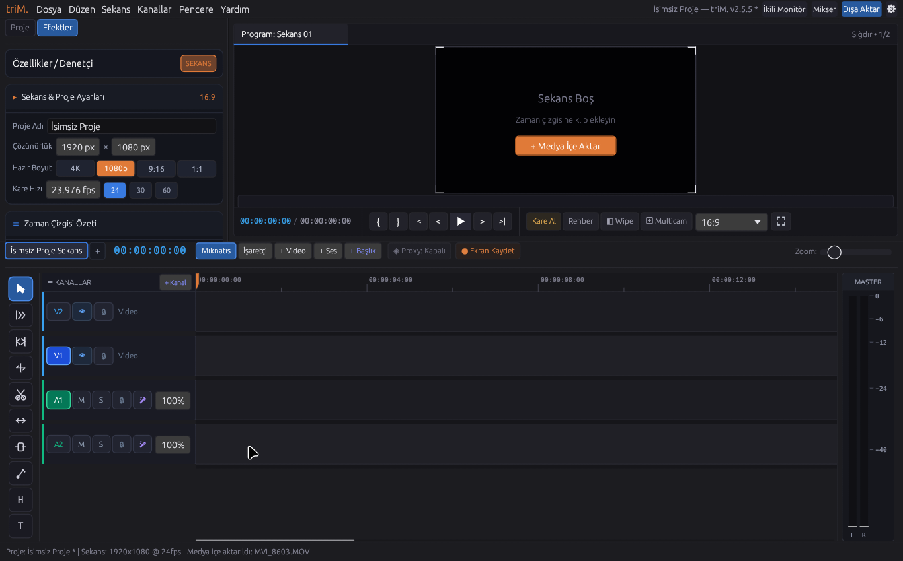

<div align="center">
  <h1>triM.</h1>
  <p><strong>Fast, private, and studio-ready desktop video editing for Windows and Linux.</strong></p>
  <p>
    <a href="https://github.com/MOzcelik14/triM/releases/latest"></a>
    
    <a href="LICENSE"></a>
  </p>
  <p>
    <a href="README.tr.md">Türkçe</a> ·
    <a href="https://github.com/MOzcelik14/triM/releases">Download</a> ·
    <a href="https://mozcelik14.github.io/triM">Website</a> ·
    <a href="https://mozcelik14.github.io/prism-suite">prisM. Suite</a> ·
    <a href="docs/SHORTCUTS.md">Shortcuts</a>
  </p>
</div>

---


## Built for Creators, Teams, and Everyday Production

**triM.** is a lightweight desktop video editor built as part of the **[prisM. Suite](https://mozcelik14.github.io/prism-suite)** ecosystem, designed for speed, reliability, and complete creative control—without subscriptions, cloud uploads, or account sign-ins. From quick social media cuts to multi-track client deliverables, triM. opens in seconds and keeps all of your media securely on your own machine.

---

## Why Choose triM.?

- **Instant & Offline**: Launch in under a second and edit anywhere with zero internet dependency.
- **No Subscriptions or Watermarks**: Every feature—from 4K export to color grading—is unlocked out of the box.
- **Familiar Workspace**: Clean, responsive interface in **English** and **Turkish**, with customizable shortcut presets matching Premiere Pro and DaVinci Resolve.
- **Smooth Performance on Any Hardware**: Automatic proxy workflow keeps high-resolution 4K footage fluid even on modest laptops.

---

## Key Capabilities

### Intuitive Multi-Track Editing
Arrange video, audio, titles, and graphics across unlimited tracks with magnetic snapping, clip linking, markers, and precision tools for cutting, ripple editing, and text overlays.

### Studio-Grade Color, Scopes & Compositing
- **Color Presets & Looks**: One-click Auto White Balance, brightness/contrast presets, 20+ cinematic and film looks, and custom `.cube` LUTs.
- **Professional Color Scopes**: Monitor exposure and color accuracy in real time with RGB Parade, Luma Waveform, Vectorscope, Histogram, False Color, and Zebra overlays.
- **Masks, Blend Modes & Adjustment Layers**: Isolate edits with interactive Rectangle, Ellipse, and Bezier masks, combine layers with 11 blend modes, and apply unified grades across tracks using Adjustment Layers.

### Clean Audio & Built-In Recording
Balance dialogue, music, and sound effects with a multi-track mixer, 3-band EQ, and loudness control—or record voiceovers, screen captures, and webcam feeds directly onto your timeline.

### Smart Time-Saving Tools
- **Automatic Scene Detection** to split long recordings into usable clips.
- **Silence Removal** to tighten talking-head videos in seconds.
- **Local Speech-to-Text** to generate editable subtitles right on your computer.

### Ready-to-Publish Export
Deliver crisp MP4, MOV, WebM, ProRes, or vertical (9:16) videos with hardware-accelerated rendering, background export queues, and preset profiles for YouTube, Instagram, TikTok, and broadcast standards.

---

## Inside the Studio

| Color Grading & Scopes | Multi-Track Audio Mixer |
| :---: | :---: |
|  |  |

| Export Studio | Vertical (9:16) Social Canvas |
| :---: | :---: |
|  |  |

---

## Download & Installation

Download the latest installer or portable archive from **[GitHub Releases](https://github.com/MOzcelik14/triM/releases)**, or use the one-command installer below:

**Windows (PowerShell):**
```powershell
iwr -useb https://raw.githubusercontent.com/MOzcelik14/triM/master/install.ps1 | iex
```

**Linux (Terminal):**
```bash
curl -fsSL https://raw.githubusercontent.com/MOzcelik14/triM/master/install.sh | bash
```

> **Note:** Windows packages include everything needed to run out of the box. On Linux, the installer automatically checks and configures required media components (`ffmpeg` and `ffprobe`).

---

## System Requirements

| Component | Minimum Requirement |
| :--- | :--- |
| **Operating System** | Windows 10 / 11 (64-bit) or Linux (64-bit) |
| **Graphics** | Any modern GPU with OpenGL 3.3+ support |
| **Storage & Privacy** | Runs 100% locally; no account or internet required after installation |

---

## Quick Keyboard Shortcuts

| Shortcut | Action |
| :--- | :--- |
| `Space` | Play / Pause |
| `J` / `K` / `L` | Rewind / Stop / Fast-forward |
| `V` / `C` / `B` | Selection / Cut / Ripple tool |
| `S` / `Ctrl + K` | Split clip at playhead |
| `Ctrl + M` | Export video |
| `F1` | Open full shortcut guide |

See the complete list in [Keyboard Shortcuts](docs/SHORTCUTS.md).

---

<details>
<summary><strong>For Developers: Building from Source</strong></summary>

Building **triM.** from source requires **Rust 1.80+** and system OpenGL/audio development libraries on Linux:

```bash
git clone https://github.com/MOzcelik14/triM.git
cd triM
cargo build --release -p trim-app
```

</details>

## License

**triM.** is open-source software released under the **GNU General Public License v3.0 (GPL-3.0)**. See [LICENSE](LICENSE) for full details.

---

## Community & Friends

If you enjoy **triM.** and open-source video editing tools, also check out and support **[NoirCut Studio](https://github.com/lakhermony/NoirCut)** — an Electron + React + WebGL2 + FFmpeg Cinema Darkroom Video Editor built by [@lakhermony](https://github.com/lakhermony). Give the repo a star! ⭐
