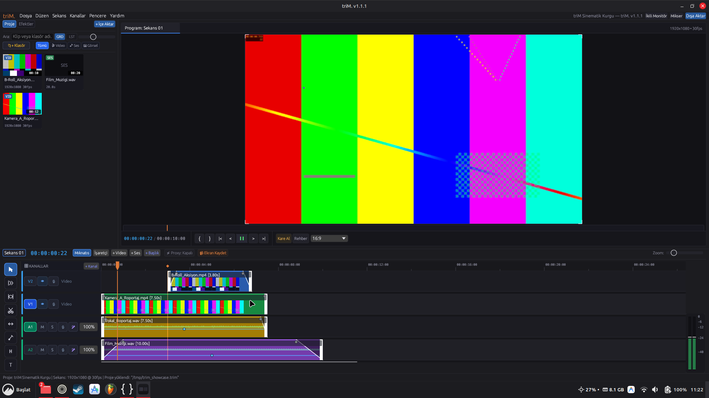
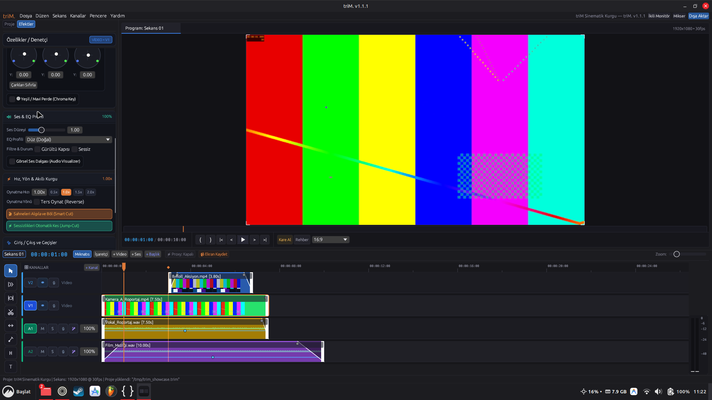
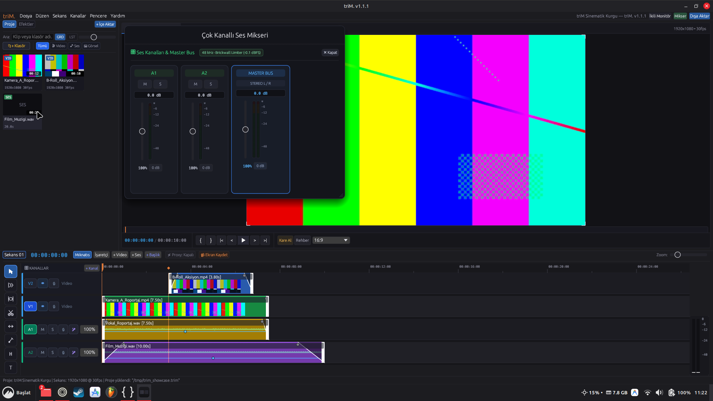
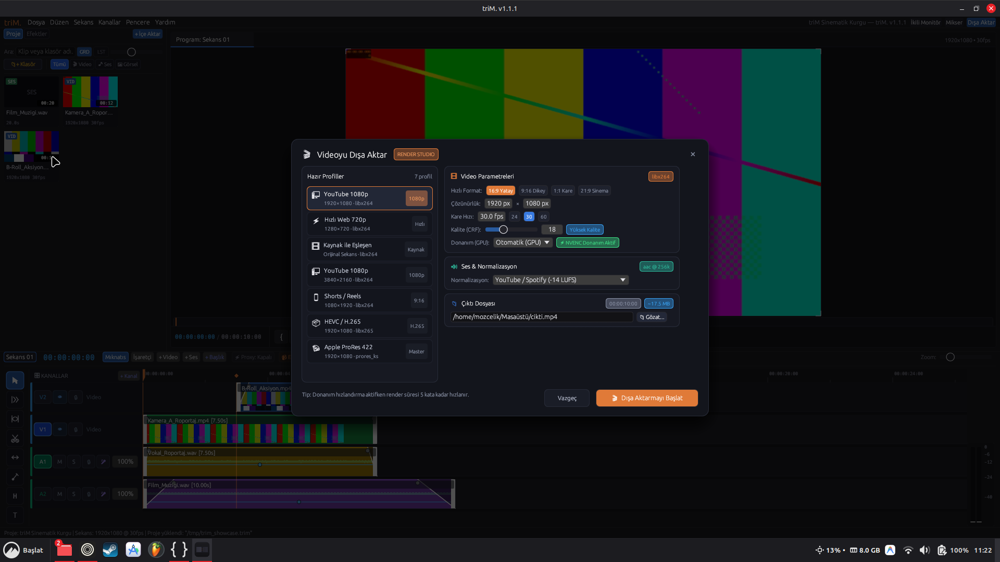
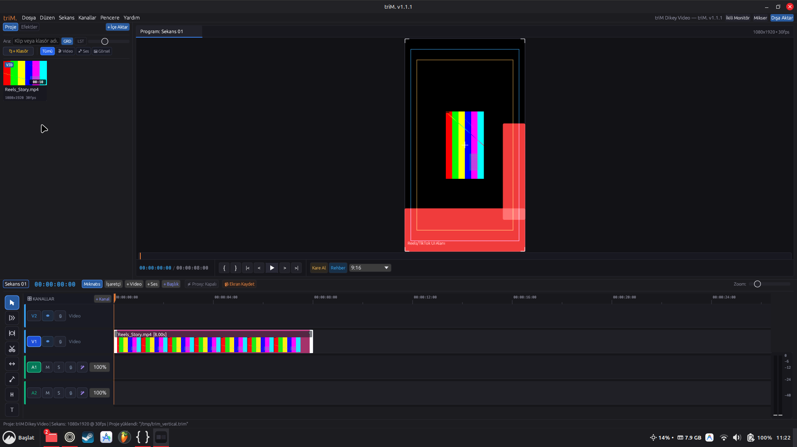

# triM.

[](Cargo.toml)
[](LICENSE)
[](#system-requirements)
[](https://github.com/MOzcelik14/triM/actions)

[Türkçe README için tıklayın](README.tr.md) · [Keyboard Shortcuts](docs/SHORTCUTS.md) · [Website](https://mozcelik14.github.io/triM.)

triM. is a native, lightweight non-linear video editor written in Rust with `egui`, using system FFmpeg for media decoding and encoding.



---

## Why I Built This

Most existing video editing software either requires hundreds of megabytes of disk space or runs inside a web browser runtime (Electron), leading to high memory overhead. For personal editing projects, I wanted a tool that starts quickly, has no external cloud or account dependencies, relies on local tools (FFmpeg, PipeWire), and keeps resource usage low.

I built triM. to serve that need. The user interface is rendered using `egui` and `eframe` over OpenGL, while video and audio decoding tasks are delegated to `ffmpeg` and `ffprobe` processes. The compiled release binary is approximately 13 MB.

---

## Core Features

### Editing & Timeline
- Multi-track video and audio timeline (V1..Vn, A1..An)
- Razor, Ripple, Slip, and Rate Stretch editing tools
- Magnetic snapping to playhead and clip boundaries
- Automatic video-to-audio clip linking and pairing (V1 -> A1, V2 -> A2 mapping)
- Timeline markers for visual navigation

### Color & Effects
- 3-Way Color Wheels (Lift, Gamma, Gain)
- 3D LUT support via `.cube` files
- Chroma Keying (green screen removal)
- Opacity controls with linear fade-in and fade-out transitions
- Keyframe support for position, scale, rotation, and opacity

### Audio Processing
- Real-time software multi-track PCM mixer (48 kHz stereo)
- Per-track gain (dB), Mute, and Solo controls
- 3-band parametric equalizer and presets (Voice clarity, bass boost, etc.)
- Timeline voiceover recording directly from microphone
- 5 ms lookahead brickwall master limiter to prevent clipping

### Export & Industry Interchange
- Export in H.264, HEVC, VP9, AV1, ProRes, and DNxHR codecs
- Automatic hardware encoder detection (NVIDIA NVENC, Intel QSV, AMD AMF, Linux VAAPI)
- EBU R128 loudness normalization (`loudnorm`) during export
- Sequence interchange via Final Cut Pro (`.fcpxml` v1.8/v1.9) and CMX 3600 (`.edl`)

---

## Screenshots

| Color Grading (Lift/Gamma/Gain) | Audio Mixer & Parametric EQ |
|---|---|
|  |  |

| Export Studio | Vertical (9:16) Canvas with Safe Zones |
|---|---|
|  |  |

---

## Installation

### System Requirements
- **OS:** Linux (x86_64) or Windows (x86_64)
- **Graphics:** OpenGL 3.3+ capable driver
- **Dependencies:** `ffmpeg` and `ffprobe` in `$PATH`
- **Linux Audio Output:** PipeWire (`pw-cat`), PulseAudio (`paplay`), or ALSA (`aplay`)

### Pre-built Binaries
Download `.deb`, `.rpm`, `.AppImage` (Linux) or `.zip` (Windows) packages from [GitHub Releases](https://github.com/MOzcelik14/triM./releases).

One-line installation on Linux:
```bash
curl -fsSL https://raw.githubusercontent.com/MOzcelik14/triM./master/install.sh | bash
```

### Building From Source
Requires Rust 1.80+ toolchain:

```bash
git clone https://github.com/MOzcelik14/triM..git
cd triM.
cargo build --release -p triM.-app
install -m 0755 target/release/triM. ~/.local/bin/triM.
```

---

## Usage

Launch the editor or pass a project file:

```bash
triM.
triM. /path/to/project.triM.
```

### Primary Shortcuts

| Key | Action |
|---|---|
| `Space` | Play / Pause |
| `J` / `K` / `L` | Shuttle backwards / Stop / Shuttle forwards (2x, 4x, 8x) |
| `C` | Razor tool |
| `S` | Split clip at playhead |
| `V` | Selection tool |
| `Delete` | Remove selected clip |
| `Shift + Delete` | Ripple delete clip and close gap |
| `Ctrl + E` | Open Export Studio |
| `F1` | Open keyboard shortcuts window |

See [docs/SHORTCUTS.md](docs/SHORTCUTS.md) for the full shortcut list.

---

## Architecture

The project is structured as 8 distinct Cargo workspace crates:

```
triM./
├── crates/
│   ├── triM.-core/       # Domain models, timecode math, clips, tracks, and projects
│   ├── triM.-commands/   # Reversible Command implementations and Undo/Redo stack
│   ├── triM.-timeline/   # Editing, slicing, and split algorithms
│   ├── triM.-project/    # Disk serialization (.triM.), autosave, and crash recovery
│   ├── triM.-media/      # FFmpeg process supervision, frame streaming, and audio mixing
│   ├── triM.-export/     # FFmpeg filtergraph generation, EDL, and FCPXML writers
│   ├── triM.-ui/         # Immediate-mode egui canvas, monitors, and inspector
│   └── triM.-app/        # Executable binary entry point
```

See [ARCHITECTURE.md](ARCHITECTURE.md) for details on the threading model, memory limits, and subprocess lifecycle guards.

---

## Known Limitations

1. **Preview Resolution:** The real-time timeline preview decodes and composites frames on the CPU at a fixed 640x360 resolution before uploading them as OpenGL textures. Heavy compositions with multiple overlapping video layers and active effects will consume CPU time during preview.
2. **Subprocess Media Architecture:** Instead of dynamically linking C libraries (`libavcodec`), triM. calls FFmpeg as isolated child processes (`ChildGuard`). This choice keeps the UI process stable and avoids codec memory crashes, but uncached seeking on long-GOP files may introduce a 15-40 ms startup delay. Using proxy mode addresses this during editing.
3. **Platform Scope:** Microphone voiceover recording and screen capture are implemented specifically for Linux (PulseAudio/ALSA and x11grab). On Windows, audio playback is handled through low-delay `ffplay`; direct microphone input is not yet supported natively on Windows.
4. **Color Depth:** The preview pipeline operates in 8-bit sRGB. 10-bit HDR source media is converted to 8-bit during preview.

---

## License

This project is licensed under the [GNU General Public License v3.0 or later (GPL-3.0-or-later)](LICENSE).
