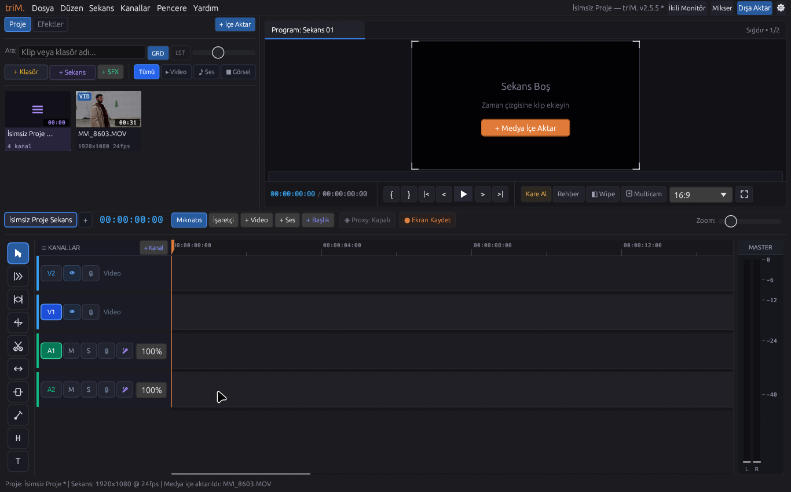
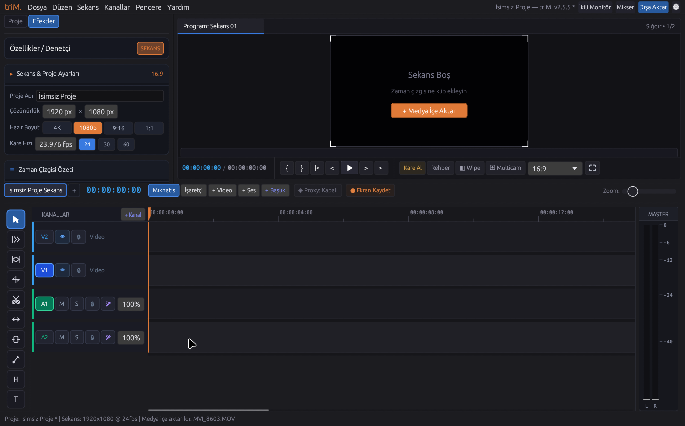
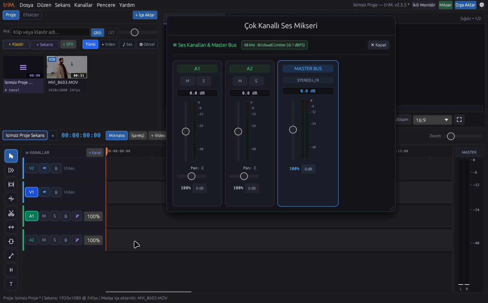
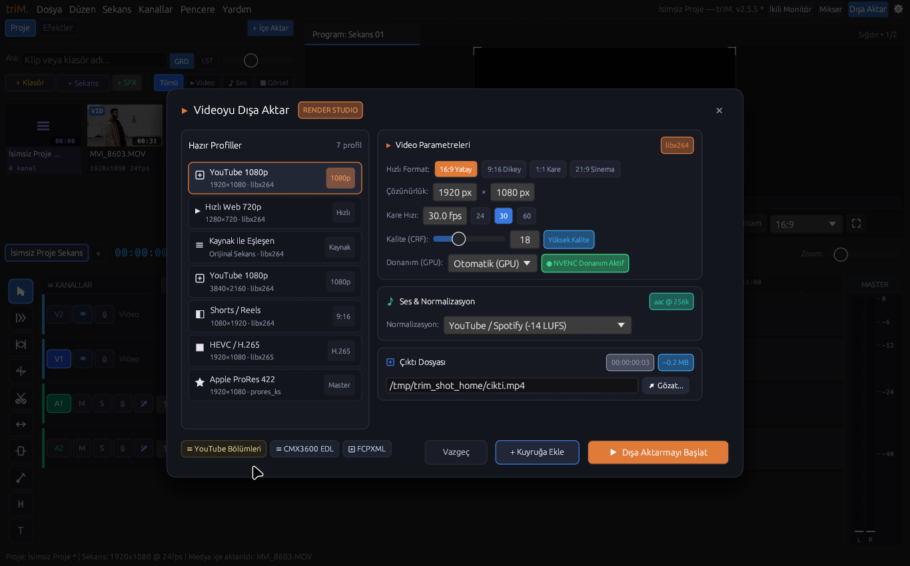
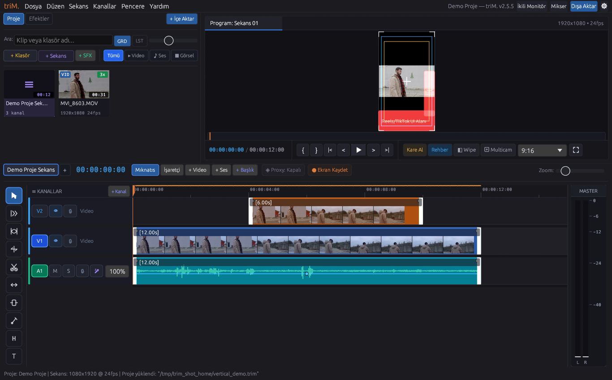
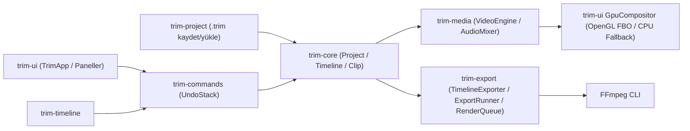

<p align="right">
  <a href="README.md">English</a> | <strong>Türkçe</strong>
</p>

<div align="center">

<h1>triM.</h1>

<p>Rust, egui, OpenGL ve FFmpeg ile geliştirilen hafif, yerel öncelikli, doğrusal olmayan (non-linear) masaüstü video düzenleyici.</p>

<p>
  <a href="LICENSE"></a>
  <a href="https://github.com/MOzcelik14/triM/releases"></a>
  <a href="https://www.rust-lang.org/"></a>
  <a href="#sistem-gereksinimleri"></a>
  <a href="https://github.com/MOzcelik14/triM/actions/workflows/ci.yml"></a>
  <a href="https://github.com/MOzcelik14/triM/commits/master"></a>
  <a href="https://mozcelik14.github.io/prism-suite"></a>
</p>

<p>
  <a href="#genel-bakış">Genel Bakış</a> |
  <a href="#özellikler">Özellikler</a> |
  <a href="#kurulum">Kurulum</a> |
  <a href="#klavye-kısayolları">Klavye Kısayolları</a> |
  <a href="#mimari">Mimari</a> |
  <a href="#geliştirme">Geliştirme</a>
</p>

<p>
  
</p>

</div>

---

## Genel Bakış

**triM.**, Linux ve Windows için Rust ile geliştirilen açık kaynaklı, doğrusal olmayan bir masaüstü video düzenleyicidir (NLE). Abonelik, bulut yüklemesi veya hesap zorunluluğu olmadan hızlı ve öngörülebilir bir kurgu ortamı arayan içerik üreticileri, teknik kurgucular ve küçük ekipler için tasarlanmıştır. Video çözümleme, önizleme kompozisyonu, ses miksajı, konuşma deşifresi ve dışa aktarma işlemlerinin tamamı kullanıcının kendi bilgisayarında yerel olarak çalışır.

Uygulama; `egui` ve `eframe` tabanlı masaüstü arayüzünü, otomatik CPU geri dönüşüne (fallback) sahip OpenGL 3.3 / GLES 3.0 framebuffer kompozitörünü (`glow`) ve FFmpeg tabanlı medya/dışa aktarma hattını bir araya getirir. Projeler okunabilir `.trim` JSON formatında atomik yazma, taşınabilir paketleme ve çökme kurtarma desteğiyle saklanır.

**triM.**, **steM.**, **beaM.** ve **draM.** ile birlikte **prisM. Suite** ekosisteminin bir parçası olarak geliştirilmektedir.

## Öne Çıkanlar

- **Yerel öncelikli mimari**: İnternet bağlantısı, hesap veya telemetri olmadan tamamen çevrimdışı çalışır; medya ve `.trim` proje dosyaları doğrudan yerel diskte tutulur.
- **Deterministik Geri Al/Yinele ile çok kanallı kurgu**: Sınırsız video ve ses kanalı, bağlı klip grupları, bileşik (Compound) ve iç içe (Nested) sekanslar, manyetik hizalama, işaretçiler ve 200 adımla sınırlı komut yığını.
- **Renk derecelendirme, scope ve kompozisyon**: Lift/Gamma/Gain renk tekerlekleri, özel RGB/Luma spline eğrileri, 6 vektörlü HSL eğrileri, 3D HSL Qualifier, `.cube` 3D LUT desteği, 2x2 Quad Scope, CIE 1931 kromatisite, ekran bölme karşılaştırması (Split-Screen Wipe), vektör maskeler ve 11 karışım modu.
- **Tümleşik ses DSP ve kayıt**: Klip başına kalıcı 6 bant parametrik EQ, kompresör, limiter, de-esser, stereo pan, reverb/echo, ana kanal lookahead brickwall limiter, sesli scrubbing ve dahili seslendirme/ekran kaydı içeren 48 kHz stereo mikser.
- **Donanım destekli FFmpeg dışa aktarma ve proje değişimi**: Çalışma zamanı donanım kodlayıcı tespiti (NVENC, QSV, VAAPI, AMF, VideoToolbox, CPU), sıralı render kuyruğu, YouTube/MP4 bölümleme ve CMX 3600 EDL / FCPXML içe ve dışa aktarımı.

## Özellikler

### Zaman Çizelgesi ve Kurgu

| Özellik | Ayrıntılar |
| :--- | :--- |
| Çok kanallı zaman çizelgesi | Görünürlük, sessize alma (mute), solo, kilit, yükseklik ayarlama ve renk etiketleri ile sınırsız video/ses kanalı. |
| Kurgu araçları | Seçim (`V`), İz Seçme (`A`), Dalgalanma (`B`), Jilet (`C`), Kaydırma (`Y`), Kalem (`P`), El (`H`) ve Metin (`T`). |
| Hassas kırpma | Standart kırpma, baştan (`Q`) ve sondan (`W`) dalgalı kırpma, dalgalı silme (`Shift+Delete`), boşluk kapatma ve kesik klip birleştirme (Join Through-Edits). |
| Çoklu klip işlemleri | Çerçeveyle çoklu seçim, toplu sürükleme, kopyala/kes/yapıştır, Özellik Yapıştır (`Ctrl+Alt+V`), klip bağlama (`Ctrl+L`) ve ses ayırma. |
| Bileşik ve iç içe sekanslar | Seçili klipleri tek bir Bileşik Klip (Compound Clip) altında toplama veya tek projede birden fazla sekans yönetme. |
| Çoklu kamera (Multicam) | Program Monitöründe 2x2 çoklu kamera görünümü ve `1` - `4` tuşlarıyla canlı açı geçişi. |
| Gezinme ve hizalama | Zaman çizelgesi işaretçileri (`M`), manyetik kenetlenme (`N`), klip üzeri kare şeridi (filmstrip), ses dalga formları ve sesli scrubbing destekli JKL shuttle oynatma. |
| Hız ve hareket | Sabit klip hızı, ters oynatma, 6 hazır profilli değişken hız rampası (Speed Ramping), perde kilidi (Pitch Lock) ve Cubic Bezier / Ease-In / Ease-Out / Hold keyframe interpolasyonu. |

### Renk Derecelendirme, Scope ve Görsel Efektler

| Özellik | Ayrıntılar |
| :--- | :--- |
| Birincil renk düzeltme | Parlaklık, kontrast, doygunluk, gamma, renk sıcaklığı, renk tonu (tint), tek tıkla Otomatik Beyaz Dengesi ve referans kareye göre tek tıkla Shot Match. |
| Eğriler ve renk seçici | Özel RGB ve Luma spline eğrileri, 6 vektörlü HSL eğrileri ve maske önizlemeli/ters çevrilebilir 3D HSL Qualifier. |
| Renk tekerlekleri ve LUT | Lift/Gamma/Gain renk tekerlekleri, 20+ dahili görünüm profili ve LRU önbellekli özel 3D `.cube` LUT dosyaları. |
| Video scope ve referans | Tekli ve 2x2 Quad Scope görünümleri (RGB Parade, Luma Waveform, Vectorscope, Histogram, CIE 1931 Kromatisite), False Color, Zebra, canlı piksel ölçüm nişangâhı, Split-Screen Wipe ve Referans Kare Galerisi. |
| Kompozisyon ve maskeler | 11 karışım modu, Ayar Katmanları (Adjustment Layer), Dikdörtgen/Elips/Bezier maskeler (Klip Alfa ve Renk/Efekt hedefleri), bölge hareket takibi, Chroma Key, Track Matte ve 4 Köşe Perspektif Bükme (Corner Pin). |
| Lens efektleri ve geçişler | Bulanıklık, keskinlik, vinyet, film greni, halation, bloom, chromatic aberration ve Cross Dissolve, Blur Dissolve, Luma Wipe, Whip Pan, Zoom Out, Glitch, Light Leak geçişleri. |

### Ses İşleme ve Kayıt

| Özellik | Ayrıntılar |
| :--- | :--- |
| Çok kanallı ses mikseri | Kanal ses düzeyi, stereo pan, mute, solo, ana çıkış kazancı, çift L/R VU metre ve `-0.1 dBFS` tavanlı 5 ms stereo-bağlı lookahead brickwall limiter. |
| Klip bazlı DSP | Ses blokları arasında korunan kalıcı DSP durumu ile 6 bant parametrik EQ, hazır EQ profilleri (Voice Clarity, Bass Boost, Podcast, Denoise Gate), kompresör/limiter/de-esser, stereo pan, reverb/echo ve ses otomasyonu keyframe'leri. |
| Akıllı ses araçları | Dalga formu zarf korelasyonu ile Otomatik Ses Senkronizasyonu (Audio Sync), otomatik sessizlik algılama/kesme ve konuşmada otomatik müzik kısma (Auto-Ducking). |
| Dahili kayıt | Doğrudan zaman çizelgesine mikrofon seslendirme kaydı ve ekran/kamera yakalama. |

### Başlık, Altyazı ve Dışa Aktarma

| Özellik | Ayrıntılar |
| :--- | :--- |
| Başlık ve tipografi | Monitör üzerinde doğrudan metin düzenleme, sistem fontu keşfi ile 31 popüler font ailesi, kalın/italik, dış çizgi kalınlığı/rengi, harf aralığı, gölge mesafesi, arka plan kutusu ve hareketli stiller (Lower Third, Typewriter, Cinematic Zoom). |
| Altyazı ve deşifre | SRT ve VTT içe aktarma, SRT dışa aktarma, kelime vurgulu karaoke stili ve yerel arka plan Whisper konuşmadan metne deşifre. |
| Dışa aktarma ve render kuyruğu | 1080p, 720p, 4K UHD, 9:16 dikey, H.265/HEVC ve Apple ProRes 422 hazır profilleri, ses yüksekliği normalizasyonu (YouTube `-14 LUFS`, Podcast `-16 LUFS`, EBU R128 `-23 LUFS`), Giriş/Çıkış aralığı dışa aktarımı ve sıralı arka plan Render Kuyruğu. |
| Proje değişimi ve bölümler | CMX 3600 EDL ve FCPXML (`xmeml` / modern FCPXML) içe/dışa aktarımı, YouTube bölüm listesi kopyalama ve MP4 içine gömülü bölüm (chapter) üst verisi. |

## Ekran Görüntüleri

| Renk Derecelendirme ve Scope | Çok Kanallı Ses Mikseri |
| :---: | :---: |
|  |  |

| Dışa Aktarma Stüdyosu | Dikey (9:16) Çalışma Alanı |
| :---: | :---: |
|  |  |

<!-- Ek ekran görüntüleri docs/images/ dizinine eklenerek buradan bağlanabilir. -->

## Kurulum

### Hazır Paketler (GitHub Releases)

Hazır kurulum paketlerini [Releases](https://github.com/MOzcelik14/triM/releases) sayfasından indirebilirsiniz. Sürüm iş akışı şu paketleri üretir:

- **Debian / Ubuntu**: `.deb` paketi
- **Fedora / RHEL**: `.rpm` paketi
- **Linux taşınabilir**: `.AppImage` ve `.tar.gz` arşivi
- **Windows (x86_64 MSVC)**: `.zip` paketi (`ffmpeg.exe`, `ffprobe.exe` ve `ffplay.exe` dahil)

### Otomatik Kurulum Betikleri

**Linux:**
```bash
curl -fsSL https://raw.githubusercontent.com/MOzcelik14/triM/master/install.sh | bash
```

**Windows (PowerShell):**
```powershell
iwr -useb https://raw.githubusercontent.com/MOzcelik14/triM/master/install.ps1 | iex
```

### Dağıtım Bazlı Paket Komutları (Linux)

Dağıtımınıza uygun sürüm paketini indirdikten sonra:

**Debian / Ubuntu (`.deb`):**
```bash
sudo apt install ./trim_*.deb
```

**Fedora (`.rpm`):**
```bash
sudo dnf install ./trim-*.rpm
```

**AppImage:**
```bash
chmod +x triM-*.AppImage
./triM-*.AppImage
```

### Kaynaktan Derleme

#### Ön Koşullar

- **Rust** kararlı araç takımı (edition 2021) ve `cargo`
- `PATH` içinde erişilebilir **FFmpeg** ve **FFprobe** (isteğe bağlı: Windows'ta `ffplay`, Linux ses çıkışı için `pw-cat`/`paplay`/`aplay`, yerel deşifre için `whisper-cli` veya `openai-whisper`)
- **Linux geliştirme kütüphaneleri** (Ubuntu / Debian):

```bash
sudo apt-get update
sudo apt-get install -y \
  build-essential pkg-config \
  libasound2-dev libpipewire-0.3-dev \
  libx11-dev libgl1-mesa-dev libxkbcommon-dev libwayland-dev \
  ffmpeg
```

#### Derleme ve Çalıştırma

```bash
git clone https://github.com/MOzcelik14/triM.git
cd triM
cargo build --release -p trim-app
./target/release/trim
```

## Başlangıç

1. **triM.** uygulamasını başlatın (Linux'ta `./target/release/trim`, Windows'ta `trim.exe`) ve karşılama ekranından ya da `Ctrl+N` ile yeni bir proje oluşturun.
2. `Ctrl+I`, Medya Havuzu içe aktarma düğmesi veya sürükle-bırak ile video, ses veya görsel dosyalarını projeye ekleyin.
3. Klipleri Medya Havuzundan video (`V1`, `V2`, ...) ve ses (`A1`, `A2`, ...) kanallarına sürükleyin. Düşük donanımda 4K görüntüler için Medya Havuzundan veya Tercihler'den 720p Akıllı Proxy oluşturabilirsiniz.
4. Oynatma için `Space` veya `J`/`K`/`L`, klip bölmek için `S` (veya Jilet aracı `C`), oynatma kafasına göre dalgalı kırpma için `Q`/`W` ve işaretçi eklemek için `M` tuşlarını kullanın.
5. Bir klibi seçip sağdaki Inspector panelinden Dönüşüm, Hız, Renk Derecelendirme, Eğriler, Maskeler veya Ses EQ/Kompresör ayarlarını düzenleyin.
6. Dışa Aktarma Stüdyosunu açmak için `Ctrl+M` (veya `Ctrl+E`) tuşlarına basın; profil ve donanım kodlayıcısını seçip hemen dışa aktarın ya da işi Render Kuyruğuna (`Ctrl+Shift+E`) ekleyin.

## Klavye Kısayolları

Aşağıdaki kısayollar doğrudan `crates/trim-ui/src/app.rs` kaynak kodundan doğrulanmıştır. Kısayol profilleri (`triM Default`, `Premiere Pro`, `DaVinci Resolve`) Tercihler (`Ctrl+,`) içinden değiştirilebilir veya `F1` ile uygulama içinde görüntülenebilir.

### Oynatma ve Gezinme

| Kısayol | İşlev |
| :--- | :--- |
| `Space` | Oynat / Duraklat |
| `J` / `K` / `L` | Geri sar / Durdur / İleri sar (2x, 4x, 8x için tekrar basın) |
| `Sol Ok` / `Sağ Ok` | 1 kare geri / ileri git |
| `Shift + Sol Ok` / `Shift + Sağ Ok` | 1 saniye geri / ileri atla |
| `Yukarı Ok` / `Aşağı Ok` | Önceki / sonraki düzenleme noktasına atla |
| `Home` / `End` | Zaman çizelgesi başına / sonuna git |
| `I` / `O` | Giriş (In) / Çıkış (Out) noktası işaretle (`Alt + X` ile temizle) |
| `F11` / `Esc` | Tam ekran Program Monitörünü aç / kapat |

### Araçlar ve Zaman Çizelgesi Düzenleme

| Kısayol | İşlev |
| :--- | :--- |
| `V` (DaVinci: `A`) | Seçim Aracı |
| `A` (DaVinci dışı) | İz Seçme Aracı |
| `B` (DaVinci: Jilet) | Dalgalanma Düzenleme (Ripple) Aracı |
| `C` (DaVinci dışı) | Jilet / Kesme Aracı |
| `Y` | Kaydırma (Slip) Aracı |
| `P` | Kalem / Anahtar Kare Aracı |
| `H` | El / Gezinme Aracı |
| `T` | Metin Aracı |
| `S` / `Ctrl + K` / `Ctrl + \` | Oynatma kafasında klibi böl (profile göre) |
| `Q` / `W` | Oynatma kafasına göre baştan / sondan dalgalı kırp |
| `Delete` / `Backspace` | Seçili klipleri sil |
| `Shift + Delete` | Seçili klipleri dalgalı sil (Ripple Delete) |
| `,` / `.` | Kaynak Monitöründen ekle (Insert) / üzerine yaz (Overwrite) |
| `M` | Oynatma kafasına işaretçi (Marker) ekle |
| `N` | Manyetik kenetlenmeyi aç / kapat |
| `1` - `4` | Multicam modunda aktif kamera açısını değiştir |
| `Ctrl + =` / `Ctrl + -` | Zaman çizelgesini yakınlaştır / uzaklaştır |

### Proje, Pano ve Paneller

| Kısayol | İşlev |
| :--- | :--- |
| `Ctrl + N` / `Ctrl + O` / `Ctrl + S` | Yeni Proje / Proje Aç / Projeyi Kaydet |
| `Ctrl + Z` | Geri Al |
| `Ctrl + Y` veya `Ctrl + Shift + Z` | Yinele |
| `Ctrl + C` / `Ctrl + X` / `Ctrl + V` | Klipleri Kopyala / Kes / Yapıştır |
| `Ctrl + Alt + V` | Özellik Yapıştır penceresini aç |
| `Ctrl + L` | Seçili klipleri bağla / ayır |
| `Ctrl + R` | Klip Hız / Süre penceresini aç |
| `Ctrl + T` | Yeni Başlık penceresini aç |
| `Ctrl + I` | Medya içe aktar |
| `Ctrl + M` veya `Ctrl + E` | Dışa Aktarma Stüdyosunu aç |
| `Ctrl + Shift + E` | Render Kuyruğunu aç / kapat |
| `Ctrl + ,` | Tercihler penceresini aç |
| `F1` | Klavye Kısayolları rehberini aç / kapat |
| `Ctrl + Q` | Uygulamadan çık |

## Desteklenen Formatlar

| Kategori | Formatlar / Uzantılar |
| :--- | :--- |
| Video girişi | `.mp4`, `.mov`, `.mkv`, `.webm`, `.m4v`, `.avi`, `.ts`, `.mts`, `.m2ts` (Sony XAVC `ipcm`/`lpcm` ses atomu algılama dahil) |
| Ses girişi | `.mp3`, `.wav`, `.aac`, `.flac`, `.ogg`, `.m4a` |
| Görsel girişi | `.png`, `.jpg`, `.jpeg`, `.webp`, `.bmp`, `.tiff`, `.gif` |
| Renk LUT dosyaları | 3D `.cube` LUT dosyaları |
| Altyazılar | `.srt` (içe ve dışa aktarma), `.vtt` (içe aktarma) |
| Proje ve değişim | `.trim` (yerel proje formatı ve eski `.cutline` okuma uyumluluğu), `.edl` (CMX 3600 içe/dışa aktarma), `.xml` (FCPXML içe/dışa aktarma) |
| Video dışa aktarma kapları ve kodlayıcılar | `.mp4` ve `.mov` ile `libx264`, `libx265`, `prores_ks` (`yuv422p10le`) ve donanım kodlayıcıları (`h264_nvenc`, `hevc_nvenc`, `h264_qsv`, `hevc_qsv`, `h264_vaapi`, `hevc_vaapi`, `h264_amf`, `hevc_amf`, `h264_videotoolbox`, `hevc_videotoolbox`) |
| Ses dışa aktarma kodlayıcıları | `aac`, `pcm_s16le` (isteğe bağlı LUFS ses yüksekliği normalizasyonlu 48 kHz stereo hat) |

## Yapılandırma ve Veri

**triM.**, ayarları, çökme kurtarma anlık görüntülerini ve yeniden üretilebilir önbellekleri `crates/trim-core/src/paths.rs` içinde tanımlı standart kullanıcı dizinlerinde saklar:

| Veri Türü | Linux Yolu | Windows Yolu |
| :--- | :--- | :--- |
| Kullanıcı tercihleri | `$HOME/.config/trim/preferences.json` | `%APPDATA%\triM\preferences.json` |
| Çökme kurtarma dosyaları | `$HOME/.config/trim/recovery/` | `%APPDATA%\triM\recovery\` |
| Disk önbellekleri (küçük resimler, filmstrip, dalga formu, proxy) | `$HOME/.cache/trim/` | `%LOCALAPPDATA%\triM\` |
| Varsayılan dışa aktarma dizini | `$HOME/Videos` (veya `Videolar` / `Masaüstü` / `Desktop`) | `%USERPROFILE%\Videos` |

Projeler seçtiğiniz konuma `.trim` JSON dosyası olarak kaydedilir. **Projeyi Paketle (Bundle Project)** özelliği kaynak medyaları, proxy dosyalarını ve özel `.cube` LUT dosyalarını `.trim` dosyasıyla birlikte taşınabilir bir klasörde toplar.

## Sistem Gereksinimleri

| Bileşen | Asgari | Önerilen |
| :--- | :--- | :--- |
| İşletim Sistemi | 64-bit Linux (Ubuntu 24.04 / Fedora veya eşdeğeri) ya da Windows 10 / 11 (64-bit) | 64-bit Linux (Wayland veya X11) ya da Windows 11 (64-bit) |
| İşlemci (CPU) | 64-bit çok çekirdekli işlemci | Çok kanallı çözümleme ve yazılım x264/x265 dışa aktarımı için 6+ çekirdek |
| Grafik (GPU) | OpenGL 3.3 Core veya OpenGL ES 3.0 destekli GPU (CPU geri dönüşü desteklenir) | NVENC, Intel QSV, AMD AMF veya VAAPI donanım kodlamalı GPU |
| Bellek (RAM) | 4 GB (yapılandırılabilir RAM önbellek bütçesi: 256 MB - 2048 MB) | 4K ve uzun zaman çizelgeleri için 8 GB veya üzeri |
| Çalışma Zamanı Bağımlılıkları | `ffmpeg` ve `ffprobe` (Windows sürüm zip paketinde dahildir) | Donanım kodlayıcı sürücüleri ve yerel deşifre için isteğe bağlı `whisper-cli` |

## Mimari

Çalışma alanı; alan modeli, geri alınabilir komutlar, medya çözümleme, FFmpeg dışa aktarma ve masaüstü arayüzü arasında net sınırlar kuran sekiz Rust crate'inden oluşur:

| Crate | Sorumluluk |
| :--- | :--- |
| `trim-core` | Alan modelleri (`Project`, `TimelineModel`, `Track`, `Clip`, `MediaItem`, `Marker`, `Sequence`), keyframe/Bezier matematiği, renk/scope, maskeler, altyazılar, değişim veri üreticileri ve yol/tercih yardımcıları. |
| `trim-commands` | `Command` trait'i, sınırlı `UndoStack` ve 30+ geri alınabilir kurgu/inspector komutu. |
| `trim-timeline` | Oynatma kafası tabanlı düzenleme noktası gezinmesi ve bölme/dalgalı kırpma akışları. |
| `trim-project` | Atomik `.trim` kaydetme/yükleme, taşınabilir proje paketleme ve `AutosaveManager` kurtarma yöneticisi. |
| `trim-media` | FFmpeg/FFprobe ikili tespiti, üst veri ve MP4 PCM atom analizi, `VideoEngine` (çok katmanlı `PlaybackStreamer`, `AsyncFrameDecoder`, LRU önbellekler), `AudioMixer` (48 kHz PCM, kalıcı klip DSP, lookahead limiter), dalga formları, küçük resimler, proxy, sahne/sessizlik algılama, Whisper ve kayıt. |
| `trim-export` | FFmpeg `-filter_complex` üretim hattı (`TimelineExporter`), arka plan `ExportRunner`, sıralı `RenderQueue`, hazır profiller ve EDL/FCPXML ayrıştırıcı/üreticileri. |
| `trim-ui` | `eframe::App` arayüzü (`TrimApp`), OpenGL `GpuCompositor`, zaman çizelgesi tuvali, monitörler, inspector, scope paneli, medya havuzu, i18n ve diyaloglar. |
| `trim-app` | Masaüstü çalıştırılabilir dosya giriş noktası (`trim`), CLI bayrakları, pencere ayarları ve gömülü uygulama ikonu. |



Daha ayrıntılı mimari açıklaması için [ARCHITECTURE.md](ARCHITECTURE.md) dosyasına bakabilirsiniz.

## Yol Haritası

[ROADMAP.md](ROADMAP.md) ve [docs/ANALIZ_RAPORU.md](docs/ANALIZ_RAPORU.md) dosyalarında izlenen planlı geliştirme başlıkları:

- **Özelleştirilebilir klavye kısayolları ve çakışma tespiti** (`ISSUE-001`): Yapılandırma dizininde saklanan kullanıcı kısayol haritaları.
- **Wayland kesirli ölçekleme hizalaması** (`ISSUE-002`): `1.25x` / `1.5x` / `1.75x` ekranlarda fiziksel piksel kenetlenmesi.
- **İçerik tabanlı disk önbelleği temizliği** (`ISSUE-008`): Disk üzerindeki küçük resim ve dalga formu önbelleklerinin boyut limitli temizliği.
- **Eğriler ve HSL Qualifier için GPU shader geçişi**: Özel eğrilerin ve 3D HSL Qualifier işleminin CPU ön geçişinden GLSL fragment shader'ına taşınması.
- **Ek kurgu araçları ve dışa aktarma paritesi**: Roll/Slide/Rate Stretch araçları, uzun projeler için bloklu (paged) PCM ses akışı ve Track Matte / HSL dışa aktarma paritesi.

## Sık Sorulan Sorular ve Sorun Giderme

**Linux üzerinde FFmpeg veya FFprobe bulunamadı uyarısı alıyorum.**
Dağıtım paket yöneticinizle FFmpeg kurun (`sudo apt install ffmpeg`, `sudo dnf install ffmpeg` veya `sudo pacman -S ffmpeg`) ya da `install.sh` betiğini çalıştırın; ardından uyarı penceresindeki Tekrar Kontrol Et düğmesine tıklayın.

**4K veya yüksek bit hızlı görüntülerde önizleme takılıyor.**
Medya Havuzundaki sağ tık menüsünden 720p Akıllı Proxy oluşturun ve Proxy modunu etkinleştirin. Ayrıca Tercihler (`Ctrl+,`) içinden RAM önbellek bütçesini artırabilirsiniz.

**OpenGL GPU kompozisyonu yerine CPU geri dönüşü çalışıyor.**
`GpuCompositor`, OpenGL 3.3 Core veya OpenGL ES 3.0 gerektirir. Donanım OpenGL desteği olmayan sanal makinelerde veya eski sürücülerde **triM.** otomatik olarak yazılım kompozisyonuna geçer.

**Yerel konuşmadan metne deşifre (Whisper) başlamıyor.**
`whisper-cli` (`whisper.cpp`) veya `openai-whisper` kurulu olduğundan ve `PATH` içinde erişilebilir olduğundan emin olun. Deşifre arka plan iş parçacığında çalışır; bu sırada arayüz yanıt vermeye devam eder.

**Linux üzerinde ses çıkışı duyulmuyor.**
`AudioStreamPlayer` sırasıyla `pw-cat` (PipeWire), `paplay` (PulseAudio), `aplay` (ALSA) ve `ffplay` araçlarını dener. Bu araçlardan en az birinin kurulu olduğundan ve varsayılan ses çıkışının etkin olduğundan emin olun.

**Klasör taşıdıktan sonra projede çevrimdışı medya görünüyor.**
Yeni klasörü göstermek için `Dosya -> Çevrimdışı Medyayı Yeniden Bağla` seçeneğini kullanın. Projeleri başka bilgisayarlara taşımadan önce `Dosya -> Projeyi Paketle` işlemini kullanmanız önerilir.

## Geliştirme

### Temel Komutlar

```bash
# Tüm çalışma alanını biçimlendir
cargo fmt --all

# Biçimlendirme kontrolü (CI adımı)
cargo fmt --all -- --check

# Uyarıları hata sayarak Clippy çalıştır
cargo clippy --workspace --all-targets -- -D warnings

# Tüm birim ve entegrasyon testlerini çalıştır
cargo test --workspace

# Optimize edilmiş sürüm ikilisini derle
cargo build --workspace --release
```

### Depo Düzeni

```text
triM/
  crates/
    trim-app/        # Çalıştırılabilir dosya giriş noktası ve CLI bayrakları
    trim-commands/   # Geri alınabilir kurgu komutları ve UndoStack
    trim-core/       # Alan modelleri, matematik, renk, scope, maske, altyazı
    trim-export/     # FFmpeg filtergraph, ExportRunner, RenderQueue, EDL/FCPXML
    trim-media/      # VideoEngine, AudioMixer, FFmpeg/FFprobe, dalga formu, kayıt
    trim-project/    # Proje kaydetme/yükleme, paketleme, otomatik kayıt/kurtarma
    trim-timeline/   # Oynatma kafası gezinme ve dalgalı kırpma/bölme yardımcıları
    trim-ui/         # egui/eframe arayüzü, GpuCompositor, diyaloglar, i18n
  docs/              # Dokümantasyon, kısayol rehberi, web sitesi varlıkları, ekran görüntüleri
  scripts/           # Linux paketleme betiği (deb, rpm, AppImage, tar.gz)
```

Commit mesajlarında açıklayıcı sürüm veya geleneksel ön ekler (`feat:`, `fix:`, `docs:`, `chore:`) kullanılır. Pull Request'lerin Linux ve Windows CI işlerinde `cargo fmt --all -- --check`, `cargo clippy --workspace --all-targets -- -D warnings` ve `cargo test --workspace` kontrollerinden geçmesi gerekir.

## Katkıda Bulunma

GitHub Issues ve Pull Request'ler aracılığıyla hata bildirimleri, kod ve dokümantasyon katkıları kabul edilmektedir. Ayrıntılı katkı iş akışı ve crate sınırları için [CONTRIBUTING.md](CONTRIBUTING.md) dosyasına bakın. Pull Request açmadan önce:

1. Çakışan çalışmaları önlemek için açık sorunları ve [ROADMAP.md](ROADMAP.md) dosyasını kontrol edin.
2. Değişiklikleri ilgili crate sınırları içinde tutun (`trim-core` arayüz ve FFmpeg bağımlılığından bağımsız kalmalıdır).
3. Yeni davranışlar veya hata düzeltmeleri için birim testleri ekleyin veya güncelleyin.
4. Yerelde biçimlendirme, Clippy ve tüm test paketinin geçtiğini doğrulayın.

## Yerelleştirme

**triM.**, `crates/trim-ui/src/i18n.rs` içinde dahili yerelleştirme altyapısına sahiptir ve şu dilleri destekler:

- **Türkçe (`tr`)** (varsayılan)
- **İngilizce (`en`)**

Üst menü çubuğu, tercihler ve birçok diyalog `Language` sözlüğünü kullanmaktadır; Inspector, Zaman Çizelgesi ve bazı ikincil diyaloglardaki metinlerin `i18n.rs` sözlüğüne taşınması kademeli olarak sürmektedir.

Yeni bir dil eklemek için:
1. `crates/trim-ui/src/i18n.rs` içindeki `Language` enum'una yeni bir seçenek ekleyin; `Language::ALL`, `from_code`, `code` ve `label` metodlarını güncelleyin.
2. `translate(lang, key)` içindeki tüm anahtarlar için çevirileri ekleyin.
3. `cargo test -p trim-ui i18n` komutu ile dil testlerini doğrulayın.

## Lisans

**triM.**, **GNU General Public License v3.0 or later (`GPL-3.0-or-later`)** lisansı altında yayınlanan özgür ve açık kaynaklı bir yazılımdır. Tam lisans metni için [LICENSE](LICENSE) dosyasına bakın.

## Teşekkürler

**triM.** aşağıdaki açık kaynaklı kütüphane ve araçlardan yararlanır:

| Bağımlılık | Görev | Lisans |
| :--- | :--- | :--- |
| [egui](https://github.com/emilk/egui) / [eframe](https://github.com/emilk/egui) | Immediate-mode arayüz ve yerel pencere yönetimi | MIT / Apache-2.0 |
| [glow](https://github.com/grovesNL/glow) | GPU önizleme kompozisyonu için OpenGL / GLES bağlamları | MIT / Apache-2.0 |
| [image](https://github.com/image-rs/image) | Görsel çözümleme ve RGBA tampon işleme | MIT / Apache-2.0 |
| [rfd](https://github.com/PolyMeilex/rfd) | Yerel işletim sistemi dosya diyalogları (XDG Portal / GTK / Win32) | MIT |
| [serde](https://serde.rs/) / `serde_json` | Proje ve tercih serileştirmesi | MIT / Apache-2.0 |
| [uuid](https://github.com/uuid-rs/uuid) | Benzersiz klip, kanal ve medya kimlikleri | MIT / Apache-2.0 |
| [thiserror](https://github.com/dtolnay/thiserror) / `log` / `env_logger` | Yapısal hata türleri ve günlükleme | MIT / Apache-2.0 |
| [FFmpeg](https://ffmpeg.org/) | Harici medya çözümleme, filtreleme, donanım kodlama ve çoklama | LGPL / GPL |

## İletişim

- **Depo**: [github.com/MOzcelik14/triM](https://github.com/MOzcelik14/triM)
- **Sorun ve Hata Bildirimleri**: [github.com/MOzcelik14/triM/issues](https://github.com/MOzcelik14/triM/issues)
- **Web Sitesi**: [mozcelik14.github.io/triM](https://mozcelik14.github.io/triM)
- **Ekosistem Portalı**: [mozcelik14.github.io/prism-suite](https://mozcelik14.github.io/prism-suite)

---

<div align="center">
  <p>Part of the <a href="https://mozcelik14.github.io/prism-suite">prisM. Suite</a></p>
</div>
