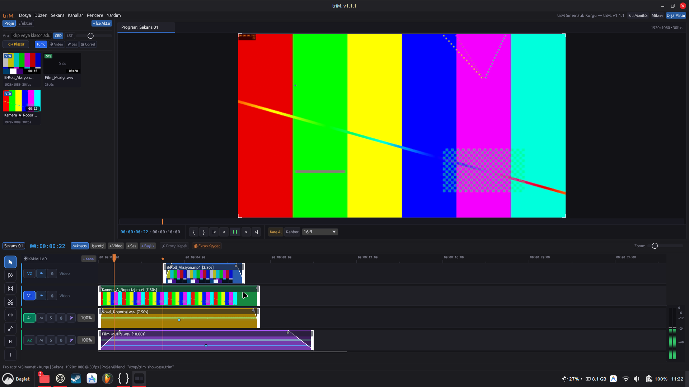
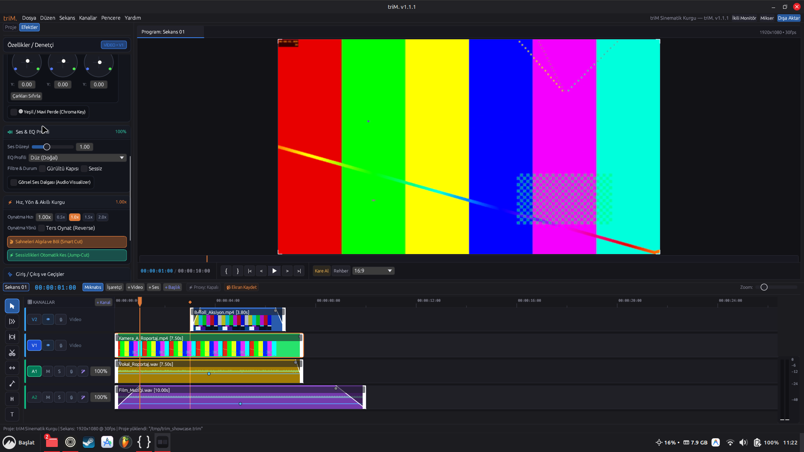
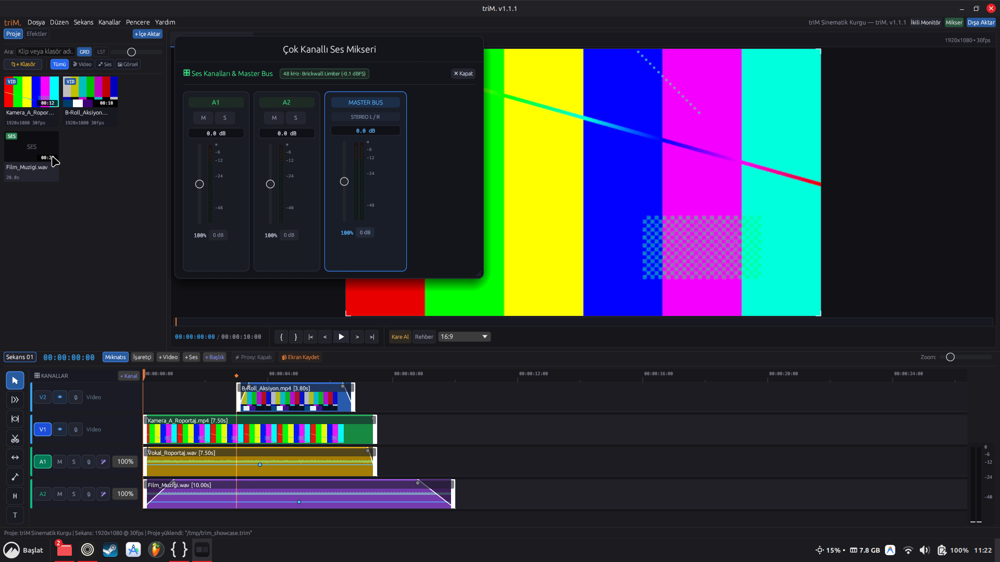
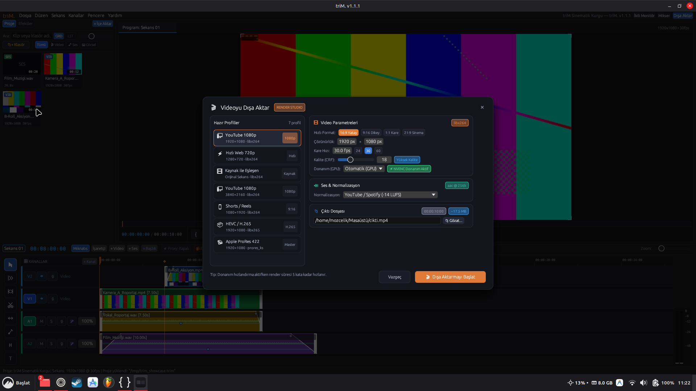
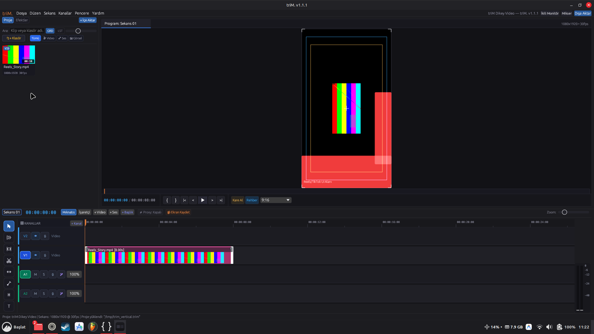

# triM

[](Cargo.toml)
[](Cargo.toml)
[](LICENSE)
[](#sistem-gereksinimleri)
[](https://github.com/MOzcelik14/triM/actions)

[English README](README.md) · [Klavye Kısayolları](docs/SHORTCUTS.md) · [Web Sitesi](https://mozcelik14.github.io/triM)

triM, Rust ve egui ile geliştirdiğim, arka planda FFmpeg kullanan hafif bir masaüstü video düzenleyicisidir.



---

## Neden Geliştirdim?

Mevcut video kurgu programlarının çoğu ya yüzlerce megabaytlık kurulum paketleriyle geliyor ya da tarayıcı motorları (Electron) üzerinde çalışarak yüksek bellek tüketiyor. Kişisel kurgu ihtiyaçlarımda hızlı açılan, harici bulut servislerine bağımlı olmayan, doğrudan yerel komut satırı araçlarıyla (FFmpeg, PipeWire) çalışan ve sistemi yormayan bir düzenleyiciye ihtiyaç duyuyordum.

triM'i bu amaçla geliştirdim. Arayüzü `egui`/`eframe` ile çiziyor, video ve ses işlemlerini sistemdeki `ffmpeg` ve `ffprobe` süreçlerine devrediyor. Derlenmiş ikili dosya boyutu yaklaşık 13 MB'tır.

---

## Temel Özellikler

### Kurgu ve Zaman Çizgisi
- Çok kanallı video ve ses zaman çizgisi (V1..Vn, A1..An)
- Jilet (C), dalgalanma (B), kaydırma (Y), seçim (V) ve metin (T) araçları
- Oynatma kafasına ve klip kenarlarına manyetik kenetlenme (N ile aç/kapat)
- Otomatik video-ses klip bağlama ve gruplama (V1 -> A1, V2 -> A2 eşleştirmesi, Ctrl+L ile aç/kapat)
- Akıllı Sahne Algılama ("Smart Cut") ile sahne değişimlerinde otomatik bölme
- Sessizlik Algılama (Jump-Cut) ile duraklamaları ve nefes aralıklarını otomatik kesme
- Whisper (`whisper.cpp`) ile yerel konuşmadan metne altyazı üretimi
- Zaman çizgisi üzerinde görsel işaretçiler (Markers - M)

### Renk ve Efektler
- GPU hızlandırmalı kompozisyon ve katman birleştirme motoru (OpenGL FBO shader'ları)
- 3 yönlü renk çarkları (Lift, Gamma, Gain) ile anlık önizleme
- Standart `.cube` formatında 3D LUT uygulama desteği
- Renk anahtarı (Chroma Key / yeşil perde ve mavi perde temizleme)
- Opaklık ve doğrusal geçişler (fade in, fade out)
- Konum, ölçek, döndürme ve opaklık için anahtar kare (keyframe) desteği

### Ses İşleme ve Kayıt
- Çok kanallı yazılımsal PCM ses mikseri (48 kHz stereo)
- Kanal başına kazanç (dB), sessize alma (Mute) ve solo kontrolleri
- 3 bant parametrik ekolayzır ve ses hazır ayarları (Konuşma netliği, bas güçlendirme vb.)
- Doğrudan zaman çizgisine mikrofonla ses kaydı (Voiceover)
- Entegre masaüstü ekran ve web kamerası stüdyosu
- Çıkışta ses patlamalarını önleyen 5 ms tuğla duvar tepe sınırlayıcı (Lookahead Master Limiter)

### Performans ve Kullanılabilirlik
- **Akıllı Proxy Kurgu:** 4K ve yüksek kare hızlı videolarda takılmasız kurgu için anlık 720p H.264 proxy modu
- **Tercihler ve Ayarlar (`Ctrl+,`):** Dil, arayüz ölçeklendirme (%80-%150), yapışma eşiği, limiter ayarı ve disk önbellek temizleme
- **Çoklu Dil Desteği (i18n):** Türkçe (TR) ve İngilizce (EN) dinamik arayüz desteği
- **Kısayol Profilleri:** triM Varsayılan, Adobe Premiere Pro ve DaVinci Resolve kısayol şablonları

### Dışa Aktarma ve Standartlar
- H.264, HEVC, VP9, AV1, ProRes ve DNxHR formatlarında çıktı alma
- Donanım hızlandırma tespiti (NVIDIA NVENC, Intel QSV, AMD AMF, Linux VAAPI) ve CPU yedeği
- Çoklu sekans render kuyruğu (`Ctrl+Shift+E`)
- EBU R128 standardında ses seviyesi normalizasyonu (`loudnorm`)
- Final Cut Pro (`.fcpxml` v1.8/v1.9) ve CMX 3600 (`.edl`) sekans aktarımı

---

## Ekran Görüntüleri

| Renk Düzenleme (Lift/Gamma/Gain) | Ses Mikseri ve Ekolayzır |
|---|---|
|  |  |

| Dışa Aktarma Stüdyosu | Dikey Kurgu (9:16) ve Güvenli Alanlar |
|---|---|
|  |  |

---

## Kurulum

### Sistem Gereksinimleri
- **İşletim Sistemi:** Linux (x86_64) veya Windows (x86_64) *(macOS kaynaktan `avfoundation` ile derlenebilir)*
- **Grafik:** OpenGL 3.3+ destekleyen sürücü
- **Gerekli Araçlar:** Sistemde kurulu `ffmpeg` ve `ffprobe`
- **Ses Çıktısı:** Linux'ta PipeWire (`pw-cat`), PulseAudio (`paplay`) veya ALSA (`aplay`); Windows'ta DirectSound / waveOut

### Hazır İkili Dosyalar
[GitHub Sürümler](https://github.com/MOzcelik14/triM/releases) sayfasından Linux için `.deb`, `.rpm`, `.AppImage` veya Windows için `.zip` paketlerini indirebilirsiniz. Windows ZIP paketleri taşınabilir FFmpeg ve FFprobe motorlarıyla birlikte gelir—ekstra kurulum gerektirmez.

Linux üzerinde tek komutla kurulum:
```bash
curl -fsSL https://raw.githubusercontent.com/MOzcelik14/triM/master/install.sh | bash
```

Windows üzerinde tek komutla kurulum (PowerShell):
```powershell
iwr -useb https://raw.githubusercontent.com/MOzcelik14/triM/master/install.ps1 | iex
```

### Kaynaktan Derleme
Rust toolchain (1.80+) kurulu olmalıdır:

```bash
git clone https://github.com/MOzcelik14/triM.git
cd triM
cargo build --release -p trim-app
install -m 0755 target/release/trim ~/.local/bin/trim
```

---

## Kullanım

Uygulamayı başlatın veya doğrudan bir proje dosyasını açın:

```bash
trim
trim /yol/proje.trim
```

### Temel Kısayollar

| Tuş | Eylem |
|---|---|
| `Boşluk` | Oynat / Duraklat |
| `J` / `K` / `L` | Geri oynat / Durdur / İleri oynat (2x, 4x, 8x hızlanma) |
| `C` | Jilet aracı (Razor) |
| `S` / `Ctrl + K` | Oynatma kafasında klibi böl |
| `V` | Seçim aracı |
| `B` | Dalgalanma aracı (Ripple) |
| `Delete` | Klibi sil |
| `Shift + Delete` | Boşluğu kapatıp sil (Ripple Delete) |
| `Ctrl + M` | Dışa aktarma stüdyosunu aç |
| `Ctrl + Shift + E` | Render kuyruğunu aç |
| `Ctrl + ,` | Tercihler / Ayarlar penceresini aç |
| `F1` | Kısayol referans penceresini aç |

Tüm klavye kısayolları için [docs/SHORTCUTS.md](docs/SHORTCUTS.md) belgesine bakın.

---

## Mimari

Proje, bağımsız katmanlara ayrılmış 8 Cargo crate'inden oluşur:

```
triM/
├── crates/
│   ├── trim-core/       # Zaman, klip, kanal ve proje veri modelleri
│   ├── trim-commands/   # Geri alınabilir (Undo/Redo) komut nesneleri
│   ├── trim-timeline/   # Kırpma ve kesim algoritmaları
│   ├── trim-project/    # Dosya kaydetme (.trim), otomatik yedekleme ve kurtarma
│   ├── trim-media/      # FFmpeg süreç yöneticisi, kare çözümleme, ses mikseri
│   ├── trim-export/     # FFmpeg filtergraph derleyicisi, EDL ve FCPXML aktarımı
│   ├── trim-ui/         # egui arayüzü, monitörler, zaman çizgisi çizimi
│   └── trim-app/        # Masaüstü çalıştırılabilir ikili giriş noktası
```

Daha fazla ayrıntı için [ARCHITECTURE.md](ARCHITECTURE.md) belgesini inceleyebilirsiniz.

---

## Bellek ve Performans Notları

1. **Bellek Tüketimi:** triM'in derlenmiş dosya boyutu ~13 MB olsa da, çalışma anında tüketilen RAM projeye eklenen medyalara göre şekillenir. Bellek taşmalarını engellemek için kod seviyesinde sınırlar konulmuştur: Video önizleme kareleri 300 karelik LRU önbelleğiyle (~276 MB), çok kanallı PCM ses önbelleği ise 512 MB ile sınırlandırılmıştır. Disk önbelleği **Tercihler (`Ctrl+,`)** ekranından izlenebilir ve tek tıkla temizlenebilir.
2. **Alt Süreç Tabanlı Medya Hattı:** C kütüphanelerini (`libavcodec`) bağlamak yerine FFmpeg izole bir alt süreç (`ChildGuard`) olarak çağrılır. Bu tercih arayüzün kararsız codec çökmelerinden etkilenmesini engeller. Uzun GOP aralıklı videolarda ilk kare arama gecikmelerini sıfıra indirmek için **Akıllı Proxy** modu kullanılabilir.
3. **Donanım Hızlandırma:** Çoklu katman birleştirme, 3 yönlü renk çarkları, 3D LUT ve yeşil perde efektleri GPU üzerinde OpenGL shader'ları ile işlenir. Dışa aktarmada NVENC, QSV, AMF ve VAAPI donanım hızlandırıcıları desteklenir; donanım bulunamazsa otomatik olarak `libx264` yazılımsal kodlayıcıya geçilir.
4. **Platform Desteği:** Zaman çizgisi oynatımı, mikrofonla seslendirme ve masaüstü/webcam kaydı hem Linux hem de Windows üzerinde tam desteklenir. macOS desteği kaynak kodda yerel `avfoundation` girişleriyle yer almakta olup, gelecekte hazır DMG paketleri de sunulacaktır.
5. **Renk Alanı:** Önizleme arayüz akıcılığı için 8-bit sRGB alanında çalışır; nihai dışa aktarma ise FFmpeg motoru üzerinden kaynağın orijinal renk derinliğinde gerçekleştirilir.

---

## Lisans

Bu proje [GNU General Public License v3.0 or later (GPL-3.0-or-later)](LICENSE) altında lisanslanmıştır.
